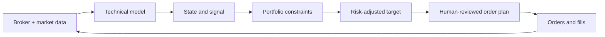

# TradingOps

TradingOps is an open-source, technical-first trading operations framework. It turns broker and market data into deterministic state, risk checks, entry/exit plans, reports, and human-reviewed order instructions.

[中文版](README_CN.md)

> This project is research and operations software, not investment advice. It does not place trades from the live pipeline. Review every output and protect all broker credentials locally.

AI agents setting up a fresh clone should start with [`AI_BOOTSTRAP.md`](AI_BOOTSTRAP.md) ([中文](AI_BOOTSTRAP_CN.md)). The complete project contract remains in [`CLAUDE.md`](CLAUDE.md); [`AGENTS.md`](AGENTS.md) is the compatibility entry point for agents such as Codex and must not replace it.

## What is included

The public repository follows the same application layout as the working system:

```text
quant/
├── core/       shared schemas, paths, structure, sizing and accounting rules
├── data/       external market-data ingestion
├── sync/       broker truth ↔ local state reconciliation
├── decision/   entry, exit, regime, drift, level and tape guards
├── options/    option selection, IV checks and premium ladders
├── risk/       portfolio and position-risk analysis
├── journal/    structured decision and trade annotations
├── report/     portfolio, performance and gate-ladder reports
├── ops/        pipeline orchestration and notifications
└── research/   offline backtests and calibration; never imported by live code

tests/           layer-mirrored unit, integration and architecture tests
tasks/           reusable scheduled-task prompts
.claude/         project rules and reusable trading/OpenD skills
trade/           AI bootstrap contracts and synthetic examples for private data
opend/           sanitized OpenD configuration template
```

Private holdings, fills, orders, NAV history, journals, market caches, research, strategies, credentials, account identifiers, and machine-specific configuration are intentionally absent. The entire `trade/` tree contains only README contracts and synthetic examples so an AI can construct the user's private workspace without changing application paths.

## System boundary

- Price structure drives `zone / gate / regime / cap` authorization.
- Fundamentals, news, earnings and macro context are information inputs; explicit sizing rules may still reduce risk around events.
- The system produces verdicts, caps, whole-unit ladders, option parameters, alerts and broker-side authorization lists.
- The canonical pipeline does not submit orders. Execution remains a manual or separately approved step.
- Broker orders and fills can be reconciled back into local state after execution.



## Main runtime paths

| Area | Responsibility |
|---|---|
| `quant/ops/pipeline.py` | Canonical stage ordering for heartbeat, briefing and post-close modes. |
| `quant/sync/` | Positions, orders, fills, watchlists and broker-state reconciliation. |
| `quant/decision/entry_guard.py` | Entry verdict, cap, integer ladder, stops and optional option plan. |
| `quant/decision/exit_guard.py` | Ratchets, ATR trails, structural exits and margin checks. |
| `quant/report/portfolio_brief.py` | Portfolio cards, risk alerts and operating brief. |
| `quant/core/` | Single sources of truth for schemas, paths, sizing and structure. |
| `tests/` | Synthetic behavior tests plus dependency, coverage and path invariants. |

## Quick start

Python 3.11 or newer is recommended.

```bash
python3 -m venv .venv
. .venv/bin/activate
python -m pip install -e '.[dev]'
pytest -q
```

Broker-connected workflows are optional:

```bash
python -m pip install -e '.[broker]'
cp .env.example .env
```

Then install and start Moomoo OpenD, fill only local values in `.env`, and review `.claude/rules/tools-environment.md`. Never commit `.env`, live state, account exports or private keys.

## AI-guided private workspace setup

Start with `trade/README.md`. It defines the machine-oriented bootstrap protocol, privacy boundary and child directory map. An AI should read the relevant descendant READMEs, copy only the examples needed by the requested workflow, and remove `.example` from the private runtime filename. For example:

```bash
cp trade/us_stock/holding/state/positions.example.json trade/us_stock/holding/state/positions.json
cp trade/us_stock/holding/state/watchlist.example.json trade/us_stock/holding/state/watchlist.json
cp trade/us_stock/market/earnings_calendar.example.json trade/us_stock/market/earnings_calendar.json
```

Files without `.example` are ignored by Git. Examples are schemas, not live data or recommended strategies; unresolved private facts must remain empty or be requested from the user rather than inferred. The runtime may create additional private state, market, research and strategy files under the same directories.

## Testing and research discipline

The test suite mirrors the `quant/` layers and locks down dependency direction, package depth, module coverage, repository references, pipeline ordering and synthetic trading behavior. Tests must not read live account state or market caches.

Research code is deliberately isolated from the live decision path. Validate backtest mechanics with synthetic or adversarial fixtures before trusting results from historical data.

## License

MIT. Third-party integrations retain their own notices and terms; in particular, review the Moomoo/OpenD disclaimers before using the bundled OpenAPI skill.
