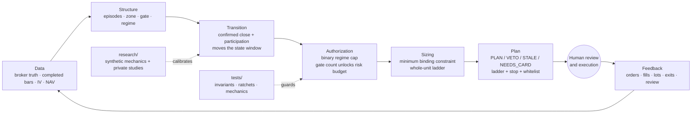
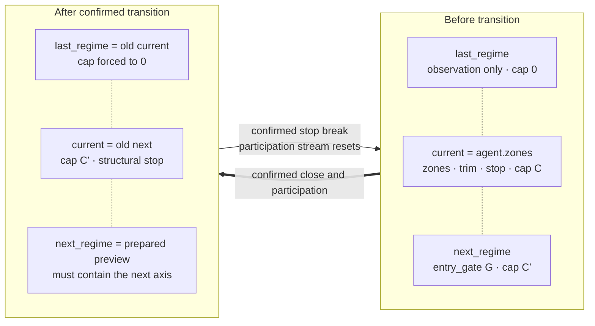
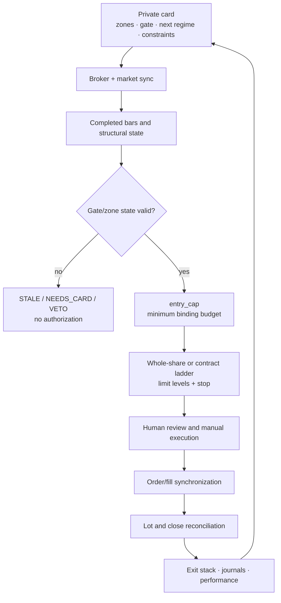
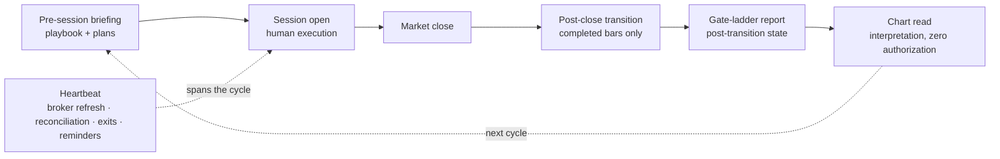
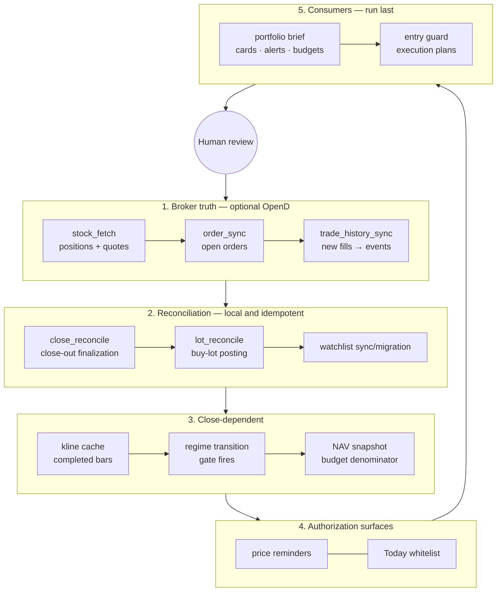

# TradingOps

TradingOps is an open-source, technical-first US-equity trading operations framework. It turns broker and market data into deterministic state, structural authorization, risk budgets, entry and exit plans, reports, and human-reviewed order instructions.

> **Operating boundary:** the machine decides whether an action is authorized and how large it may be; a human decides whether to act and performs execution. The canonical pipeline never submits orders.

[中文版](README_CN.md)

AI agents setting up a fresh clone should start with [`AI_BOOTSTRAP.md`](AI_BOOTSTRAP.md) ([中文](AI_BOOTSTRAP_CN.md)). The complete project contract remains in [`CLAUDE.md`](CLAUDE.md); [`AGENTS.md`](AGENTS.md) is the compatibility entry point for agents such as Codex and must not replace it.

Three directories carry the operating model:

| Directory | Role | One line |
|---|---|---|
| **`quant/`** | Code | Layered package with one executable source of truth per rule and one-way dependencies. |
| **`tests/`** | Executable specification | Rules become invariants that can fail rather than prose that can drift. |
| **`tasks/`** | Scheduled-task source | Reusable prompts stay under version control; registration remains a separate local action. |

All three serve one central concept: the **gate**.

> This project is research and operations software, not investment advice. Protect broker credentials and private state locally, validate every output, and keep execution human-reviewed.

## The system in ten seconds



The middle chain—transition → authorization → sizing—is gate-driven. It separates market-structure evidence from discretionary execution and keeps every downstream surface on the same mechanical state.

---

## Gate philosophy — the foundation of the system

A gate is the system's **state-transition axis**: a landmark price level where the market has repeatedly made decisions. Downtrends, repairs, ranges and uptrends can all contain gates. Zones, regimes, caps, ladders, exit rules, authorization lists and operational reports are downstream of this concept.

### 1. A gate is discovered, not assigned

A landmark level is a property of the price series rather than a convenient number chosen by an operator. Evidence can include:

- repeated pivot clusters and role changes;
- binding supply or demand clusters;
- high-volume and low-volume node boundaries;
- meaningful swing highs or lows;
- anchored VWAP or moving-average convergence;
- prior structural extremes or the origin of a breakdown.

This has three consequences:

1. **The gate is independent of a regime label.** Classification reads price history and structure, not a card name.
2. **The gate is independent of trend direction.** The same concept can stop a decline, cap an advance or define a repair reclaim.
3. **The evidence bar cannot be lowered for convenience.** A weakly supported line is an observation, not an authorization axis.

A card without a defensible gate is not merely missing a field; its chart has not yet been fully mapped.

### 2. A gate is multi-dimensional confirmation

No single indicator is sufficient. A level becomes structurally meaningful when multiple independent dimensions converge:

| Dimension | Typical evidence |
|---|---|
| Pivot cluster | Touch count and two-way high/low role changes |
| Volume distribution | HVN boundary or the edge of an LVN void |
| Seller/buyer presence | Rejection count plus recency |
| Dow structure | `last_swing_high` or `last_swing_low` |
| Dynamic references | MA50, MA200 or an anchored VWAP |
| Historical structure | Prior extreme or breakdown origin |

A synthetic example illustrates the distinction: a level supported by a swing high, repeated two-way touches, a moving average and recent failed pushes has multi-dimensional evidence. A line located inside a volume block with only stale rejections does not, even if several indicators appear nearby.

Automated audits are advisory: they can detect a skipped swing level or an invalid relationship, but they cannot prove that the human structural reading has enough independent evidence.

### 3. A gate is the interface that moves state upward

Each card holds a rolling three-state window:

```text
agent.last_regime   observation state below current; cap always 0
agent.zones         current state: zones, trim, no-chase, stop and cap
agent.next_regime   state after a confirmed gate reclaim; may authorize a cap
```

A promotion moves the **whole chart**, not only the cap. The stop, no-chase level, trim area, accumulation zones and next transition axis move together:



A card without `next_regime.entry_gate` can move only once because it has no prepared path into the following state. The executable criterion lives in `quant/core/structure.py`; early signals inside the current regime and historical repair levels do not substitute for the next transition axis.

### 4. Transitions are mechanical

Confirmation is encoded in the gate definition and transition engine:

- completed closing prices, never an unfinished intraday bar;
- the configured number of confirming closes;
- a relative-volume participation leg;
- an explicitly scoped magnitude fast lane;
- deterministic stop and state-window updates.

A transition does not wait for discretionary confirmation. Exit execution and state transition are separate concerns: an operator may decline an order, but that does not rewrite what the market structure did.

After promotion:

- mechanical fields such as cap, stop, no-chase and participation state take effect immediately;
- provisional zones may carry `pending_repaint`;
- while repaint is pending, `entry_guard` returns `NEEDS_CARD` and grants no entry authorization;
- close-dependent stages operate only on completed bars.

### 5. A gate is insurance, not alpha

The preregistered gate studies show a deliberate trade-off: confirmation can reduce stop-out frequency and improve the left tail while paying an average-return premium. The resulting design is defensive authorization rather than a claim that gates forecast excess return.

Consequences:

- the gate domain is narrow and explicit rather than imposed on every new position;
- averaging-down protection comes from a cap of zero, not from freezing a gate;
- promoted holdings may receive incremental add-on authorization only through the next confirmed state;
- changing confirmation or stop semantics requires rerunning the designated research mechanics.

Reusable research mechanics live under `quant/research/`; private protocols, datasets, results and rulings remain in the ignored workspace. Live code never imports the research layer.

### 6. Gate and zone live, expire and anchor together

A gate and its zones come from the same structural reading. If the zone is stale, the gate is stale. If one is redrawn, both must share the same structural anchor.

The shared rules in `quant/core/structure.py` enforce:

1. **same lifetime** — stale zones imply a stale gate;
2. **same anchor** — gate and zone anchors must agree within the allowed tolerance;
3. **coherence** — an upward gate must be consistent with no-chase and stop relationships.

Re-verifying evidence is not re-anchoring. Updating a receipt or rejection count changes the basis text; it does not invent a new structural anchor. The next-regime gate anchor is constructed by the controlled update path rather than hand-written.

### 7. How a gate becomes a risk budget

Gate count represents cap-granting upward transitions in the current participation stream, not fill count and not every observed level. A breakdown or completed close-out resets the stream.

The campaign budget is unlocked through cumulative gate ceilings. Current exposure consumes the available room:

```text
gate count   derived from cap-granting transitions in agent.regime_history
budget       cumulative NAV-risk ceiling for the active gate count
conversion   NAV × risk ceiling ÷ stop distance − current market exposure
stop         the first binding structural/ratchet/trend line
```

`quant/core/sizing.py` is the single source of truth. `sizing.entry_cap()` selects the minimum binding constraint across:

1. current regime notional cap;
2. gate risk-budget room;
3. at-risk ceiling;
4. portfolio shock-budget room;
5. gross-exposure room;
6. current buying power.

The plan must report the binding constraint. A nominal regime cap is a ceiling, not an allowance. The same sizing function feeds the entry plan, authorization list and operational reporting so they cannot silently disagree.

### 8. A gate's structural identity

The four-way classifier in `quant/core/episodes.py` determines which structural path a gate belongs to:

| Class | Structural question | Authorization meaning |
|---|---|---|
| Repair reclaim | Did price suffer a material breakdown and then reclaim a landmark? | Insurance domain; confirmation may restore participation. |
| Trend continuation | Is the level part of an already healthy trend? | Observation unless a reviewed rule grants add-on authorization. |
| Range boundary | Is price rotating inside a broad structure without a qualifying breakdown? | Structural context, not automatically a repair gate. |
| New-high line | Is the level a historical extreme with no overhead structure? | Breakout context with its own evidence requirements. |

The classifier reads episodes and price mechanics, not descriptive card labels.

### 9. Gate-drawing checklist

Before accepting a gate:

1. identify the structural class;
2. record at least two independent evidence dimensions;
3. check rejection/touch recency rather than count alone;
4. confirm the level is a boundary rather than the middle of a volume block;
5. define close count and participation requirements;
6. define the destination regime, cap and structural stop;
7. construct the next-regime preview at the same time;
8. anchor gate and zones to the same observation set;
9. run `gate_audit` and relevant schema checks;
10. treat unresolved evidence as review work, never as authorization.

### Where gate behavior lives

| Concern | Source of truth |
|---|---|
| Episode and structural classification | `quant/core/episodes.py` |
| Gate/zone lifetime and anchors | `quant/core/structure.py` |
| Technical evidence | `quant/core/technical.py`, `quant/core/patterns.py` |
| Transition mechanics | `quant/decision/regime_transition.py` |
| Entry authorization and plan | `quant/decision/entry_guard.py` |
| Sizing and gate budget | `quant/core/sizing.py` |
| Exit stack | `quant/decision/exit_guard.py` |
| Gate audit and reporting | `quant/report/gate_audit.py`, `quant/report/gate_ladder_report.py` |

---

## How it runs: the life of one trade



Three principles keep the loop coherent:

1. Card construction is judgment and execution is human; state updates, guards and reconciliation are mechanical.
2. `entry_cap` is the sizing funnel for every downstream surface.
3. Closing is not the end of the data lifecycle: reconciliation can return a reviewed card to the candidate pool for a future campaign.

### What an operating day looks like



The ordering is deliberate: transition precedes ladder reporting, and chart interpretation reads the post-transition state. Exact schedules are operator-local and must account for timezone, exchange calendars and daylight-saving changes.

---

## `quant/` — the code

Dependencies flow downward only. Upper layers may import lower layers; the reverse is forbidden. Package depth is fixed at `quant/<layer>/<module>.py`, and tests enforce the rule.

```text
  ops          orchestration / notification
   ├── report  read-time reports; no canonical state creation
   ├── journal structured ledger writes
   ├── decision mechanical guards and transitions
   │    ├── options  contract-level parameters
   │    └── risk     sizing and concentration aids
   ├── sync    broker truth ↔ private state
   ├── data    external world → private caches
   └── core    pure shared libraries and executable truth sources

  research     historical verification bypass; never imported by live code
```

### `core/` answers “who decides?”

| Module | Single source of truth |
|---|---|
| `sizing.py` | Regime cap, gate budget and whole-unit ladder |
| `structure.py` | Gate/zone lifetime, anchoring and card regime derivation |
| `episodes.py` | Breakdown mechanics and structural class |
| `holdings.py` | Holding identity derived from broker quantity |
| `book.py` | NAV, per-name shock and gross book usage |
| `technical.py` | Indicator and volume-profile math |
| `patterns.py` | Pattern classifiers |
| `earnings.py` | Event-day sizing and redraw SLA |
| `schema.py` / `io_json.py` | Validation, locking and atomic writes |

Detailed import, bootstrap and path rules live in [`quant/README.md`](quant/README.md).

### Running it

Use the interpreter from the isolated environment created by the bootstrap guide:

```bash
python -m quant.ops.pipeline --mode briefing --json
python quant/decision/entry_guard.py --json
python quant/report/portfolio_brief.py --read-only --json
```

Use `--read-only` when inspecting the brief interactively; the default operational mode can consume alert-cooldown state.

---

## `tests/` — the executable specification

A rule that is not represented in executable behavior can drift without warning. Tests therefore mirror the application layers and also guard the repository itself.

```bash
python -m pytest -q
python -m pytest tests/core -q
python -m pytest --collect-only -q
```

Do not copy a collected-test count into documentation; query it when needed.

### Repository guards

| Guard | What it pins |
|---|---|
| `tests/test_layering.py` | One-way dependencies, fixed depth, bootstrap form and research isolation |
| `tests/test_module_coverage.py` | `quant/<layer>/` ↔ `tests/<layer>/` mirror and a shrinking `UNTESTED` ratchet |
| `tests/test_repo_references.py` | Internal paths in maintained code/docs exist; optional local task copies match their sources |
| `tests/test_constant_pins.py` | Deliberately duplicated cross-module constants remain equal |
| `tests/test_live_data_isolation.py` | Offline tests do not silently consume private live data |

Architecture and coverage guards must be mutation-tested: inject representative violations and confirm every clause actually fails.

### `tests/research/` — synthetic verification before real data

Research can change parameters that affect live authorization, stops and budgets. The discipline is:

- preregister definitions, timing, statistics and verdict rules;
- use synthetic data while implementing and testing mechanics;
- run authorized historical data only after the mechanics are locked;
- preserve a rulings ledger for adopted, rejected and scoped findings.

The degrees-of-freedom audit and `UNTESTED` list are ratchets, not documentation counters. Read their executable baselines instead of copying numbers into prose.

---

## `tasks/` — reusable scheduled-task prompts

`tasks/` is the version-controlled prompt source. It does not prove that any task is registered locally.

| Task | Purpose |
|---|---|
| `heartbeat` | Periodic broker refresh, reconciliation, reminders and risk/exit patrol |
| `overnight-briefing` | Pre-session macro, portfolio and entry-plan briefing |
| `postclose-transition` | Apply close-confirmed regime transitions |
| `gate-ladder-report` | Render the post-transition gate ladder |
| `chart-read` | Interpret completed-bar structure with zero authorization power |
| `weekly-portfolio-review` | Review exposure, process, data quality and rule adherence |

Three rules:

1. Edit the repository prompt first, then update an authorized local task copy.
2. Writing a prompt file is not task registration; verify the runtime registry.
3. Schedules must be reviewed for timezone, exchange calendar and daylight-saving changes.

Local task-copy reconciliation is opt-in through the environment described in `tests/test_repo_references.py`. Public CI never depends on a user's task registry.

---

## Runtime loop

`quant/ops/pipeline.py` is the canonical orchestrator. Stage order is code, not duplicated prose.



Ordering constraints:

- fills precede lot and close reconciliation;
- NAV lands before budget-dependent reports and authorization surfaces;
- reports run after state collection so they never consume a half-built snapshot.

| Mode | Role |
|---|---|
| `heartbeat` | Broker refresh, reconciliation, reminders, whitelist and exit patrol |
| `briefing` | Full run including completed bars, transitions, snapshots, drift and entry plans |
| `postclose` | Lean completed-bar chain for prompt after-hours state |

### Standing infrastructure alerts

The brief reports fail-silent classes explicitly, including:

- ledger/broker lot or quantity drift;
- gate/zone anchor desynchronization;
- missing next gate or missing zone anchor;
- stale event calendar or post-event card;
- option exposure with a missing underlying card;
- fills without an authorization stamp;
- blocked card promotion;
- unavailable OpenD.

Alerts share a cooldown state so multiple operating modes deduplicate the same condition.

---

## State and data ownership

Private runtime state follows the contracts under [`trade/README.md`](trade/README.md).

| Store | Ownership / semantics |
|---|---|
| `trade/us_stock/holding/state/positions.json` | Position-card truth: broker block, agent-owned structure, lots and pending orders |
| `trade/us_stock/holding/state/watchlist.json` | Candidate cards and reviewed entry analysis |
| `trade/us_stock/holding/state/exit_guards.json` | Script-owned ratchet, trail and re-entry state |
| `trade/us_stock/holding/events/` | Append-only fills, decisions and NAV events |
| `trade/us_stock/market/` | Private/generated market caches and licensed data |
| `trade/us_stock/knowledge/` | Private research cards and evidence |
| `trade/us_stock/strategy/` | User-specific policies constructed from explicit input |

Broker-derived blocks are written only by `quant/sync/`. Paths, schemas, locked atomic writes, holding identity, structure and sizing formulas live in `quant/core/`.

The public `trade/` tree contains only README contracts and synthetic `*.example.*` schemas. Never commit populated runtime files.

---

## Research workspace

`quant/research/` is an isolated public scaffold for reusable validation mechanics. Private studies produce statistics, not actions, and live code may not import the research layer.

- Criteria are preregistered before results.
- Synthetic tests validate mechanics before authorized historical runs.
- [`quant/research/README.md`](quant/research/README.md) defines the AI bootstrap and public/private boundary.
- Populated preregistrations, datasets, reports, charts, rulings and backlog remain ignored private artifacts.
- Before proposing a parameter change, inspect the live parameter and rerun the authorized private study for its domain.

---

## System boundary

TradingOps is a technical-first, rule-driven, semi-automated framework—not an end-to-end ML strategy and not an autonomous execution bot.

- Structural price evidence drives `zone / gate / regime / cap` authorization.
- Fundamentals, research, earnings and macro context are information inputs; explicit event-risk rules may adjust size.
- The hot path classifies current state rather than producing a unified return forecast.
- Portfolio construction is constraint and budget based, not a covariance optimizer.
- The system produces limits, units, stops, option parameters, alerts and authorization lists.
- Execution remains manual or separately approved; the live pipeline never calls bundled order-placement scripts.
- Orders and fills can be synchronized back into state, ledgers, journals and performance review.

Private holdings, watchlists, fills, journals, active-universe caches, research, strategies, credentials and account identifiers are intentionally absent from the public repository.

---

## Quick start

Python requirements and dependency pins live in `pyproject.toml`.

```bash
python3 -m venv .venv
. .venv/bin/activate
python -m pip install -e '.[dev]'
python -m pytest -q
```

Broker-connected workflows are optional:

```bash
python -m pip install -e '.[broker]'
cp .env.example .env
```

Then follow [`AI_BOOTSTRAP.md`](AI_BOOTSTRAP.md), [`opend/README.md`](opend/README.md) and [`.claude/rules/tools-environment.md`](.claude/rules/tools-environment.md). Keep real values local.

## License

MIT. Third-party integrations retain their own notices and terms; review the Moomoo/OpenD disclaimers before using the bundled OpenAPI skill.
