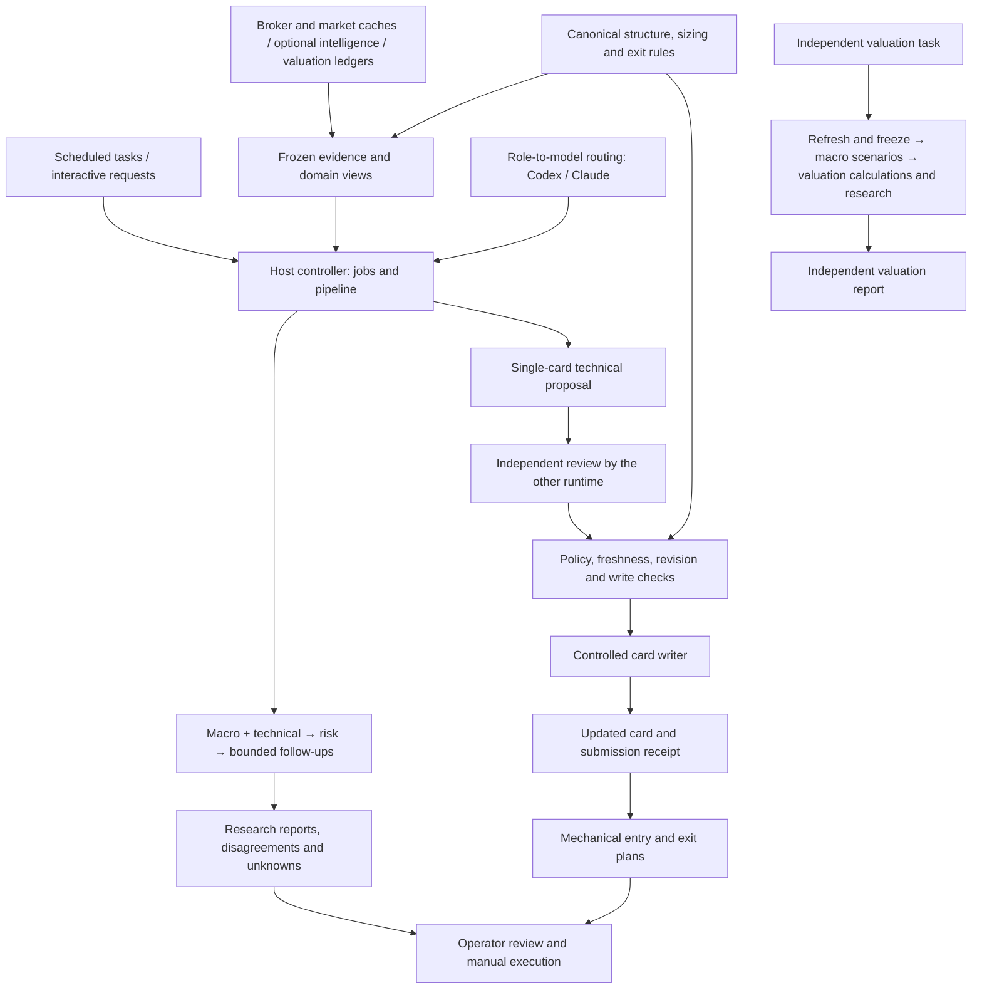

# coreytrading

A US-equity trading operations system built around **domain agents, interchangeable model runtimes, and executable trading rules**. Codex and Claude collaborate on research; a host controller validates their outputs and applies reviewed card updates. Orders are placed manually.

[中文版](README_CN.md) · [Agent operations](agents/README.md) · [Code architecture](quant/README.md) · [Scheduled tasks](tasks/README.md) · [Trading data](trade/README.md) · [AI bootstrap](AI_BOOTSTRAP.md)

The project contract for every model is [AGENTS.md](AGENTS.md) (read natively by Codex and Claude Code ≥ 2.1.277); [CLAUDE.md](CLAUDE.md) is a one-line `@AGENTS.md` import shim for older Claude Code runtimes.

Trading covers US equities and the existing US equity-options workflow. Cross-asset macro data supplies context and research inputs only; it never becomes an additional trading market.

## Architecture

The unit of responsibility is a domain role. Its methods, evidence requirements and output permissions live separately from its model assignment. Changing a role from Codex to Claude changes its route; the role contract and trading rules continue to apply.



The model handles interpretation and collaboration. Python owns data ingestion, numerical calculations, process limits, validation and state mutation. Workers receive frozen evidence and return structured JSON; they cannot access the workspace, call the broker, send messages or place orders.

## Default agent assignments

| Agent | Runtime (when it runs) | Independent reviewer runtime | Responsibility |
|---|---|---|---|
| **Macro** | **Codex** (weekly review / daily valuation) | Claude Code | Interpret existing macro evidence, regimes and uncertainty; provide context |
| **Technical analysis** | **Claude** (the only daily model role; reused for the same close and card revisions) | Codex CLI | Read price structure, gates and zones; propose individual card updates |
| **Risk and position management** | Daily: code-rendered receipt (`quant/report/risk_receipt.py`); weekly: **Claude** | Codex CLI | Review whole-book exposure, buying power, stops and sizing receipts |
| **Valuation** | **Codex** (independent daily job) | Claude Code | Interpret financial statements, valuation ledgers, scenarios and implied expectations |

[agents/routing.json](agents/routing.json) is the configuration source of truth. A role, runtime, model provider and model ID are separate concepts: macro is a role, Codex CLI is a runtime, OpenAI is a provider, and a particular GPT version is a model. Routing v2 defines explicit `model_profiles`; each role selects a primary profile and an independent reviewer profile.

| Model profile | Primary model | Secondary model | Explicit effort |
|---|---|---|---|
| Anthropic / Claude Code | `claude-fable-5-1` | `claude-opus-5` | `xhigh` (extra high) |
| OpenAI / Codex CLI | `gpt-6-astra` | `gpt-5.6-sol` | `high` |

Primary, fallback and reviewer calls all carry explicit model and effort parameters. These settings do not inherit the desktop conversation's model. Receipts distinguish requested settings from model IDs actually reported by CLI metadata; absent or multiple reported models remain explicit rather than being replaced with the requested ID. A reviewer is invoked when review is requested; whether card submissions require independent approval is set by `autopaint.review`.

A valid abstention is retained. The current production configuration disables model fallbacks and independent review; failures remain failures with the assigned provider. The controller retains configurable failover and review support for an explicit re-enable. An explicit session quota error skips remaining models on that runtime for the current run. Review selects the runtime opposite the actual research provider; if it is unavailable, research is retained as needs_review and cannot be submitted. Refusal to approve does not trigger another model. Model upgrades follow the documented [model maintenance policy](agents/MODEL_POLICY.md), with explicit versions and validation before activation.

## How agents collaborate

1. **Capture evidence.** The host reads existing state and caches, records their owners, timestamps and hashes, and freezes a shared snapshot with a view for each role. Capturing data does not refresh it; missing or stale evidence stays visible.
2. **Research in parallel.** Macro and technical agents analyze their assigned views in the trading workflow. The separate valuation workflow runs macro scenarios, host calculations and valuation research in sequence. Outputs distinguish observations, hypotheses, risks and unknowns, with references bound to the captured evidence.
3. **Review the portfolio.** The risk agent receives its original inputs and the current macro and technical reports. Its view includes all managed holdings, including option-specific exit rules and available Greeks. Amounts come from the existing mechanical calculations.
4. **Resolve focused questions.** Cross-domain requests are grouped by recipient for at most one follow-up round. Unresolved questions remain in the record. Repeating a claim through another model does not create independent evidence.

The current configuration allows two parallel calls and eight calls per workflow, with no automatic follow-up round. A shared host limit also caps concurrent native calls at two and calls within a rolling hour at 12. Fallbacks consume the same budget; concurrency waits are bounded. These limits control this system's workload, not either provider's account quota or billing.

With `execution_transport = desktop` the host does not start model CLIs: packets are written under `var/agent-runs/desktop/`, and each runtime's desktop session claims, answers and completes them under [tasks/desktop-research.md](tasks/desktop-research.md). Orchestration, frozen evidence, controlled submission and applied receipts stay with the host. The daily loop runs only the technical role; risk receipts are code-rendered and the three-role workflow runs only in the weekly review.

## Reviewed automatic card updates

The current configuration enables `autopaint.enabled` and `autopaint.apply` with `autopaint.review=false`. Technical proposals pass the host evidence, revision and mechanical-policy checks before writing, without a second model review. New run records bind that review policy; older records still require review by default. Receipts mark model review as not required, rather than approved. Eligible missing or stale cards can enter the automatic update flow. Portfolio reports themselves do not write cards; each target gets a separate technical proposal, and independent model review is controlled by the host policy.

The host checks the original evidence, result and policy bindings, expiry, permitted arguments and the target's current revision. It saves a before-image backup and a prepared submission receipt before invoking the existing [card writer](.claude/skills/trading-analysis/scripts/update_position_zones.py). Broker-owned fields, lots, pending orders and binding constraints remain protected.

| Result | Meaning |
|---|---|
| `succeeded` | A model result passed the research contract; it does not prove a card was written |
| `needs_review` | Evidence, review or submission checks require attention |
| `partial` | A job finished with failed or pending work recorded |
| `applied` | The target card update has a confirmed submission receipt |

Setting `autopaint.apply` to false returns automatic card work to research and preview. The switch is checked again before an automatic commit, including for work already in progress. It does not undo completed writes. Explicit selection of a single proposal through `submit --apply` is a separate manual submission path, documented in the [operations manual](agents/README.md).

An uncertain write is reconciled against its prepared before/after hashes. Recovery updates the receipt; it does not blindly repeat a card write. Run artifacts, card backups and health events retain the evidence needed to investigate a case.

## Daily operation

Any scheduler that can run a prompt with a coding agent (a desktop task runner, cron with a CLI agent) can trigger the six trading tasks. The Python controller chooses the domain runtimes independently of that scheduler.

| Task | Domain work |
|---|---|
| `heartbeat` | Broker/state reconciliation, mechanical risk and exit alerts, health checks and nonblocking missing-card dispatch |
| `overnight-briefing` | Refresh daily inputs, run the technical role (reused when the close and cards are unchanged) with the code-rendered risk receipt, process the repaint queue and prepare entry plans |
| `postclose-transition` | Evaluate exits, apply completed-session transitions, render transition receipts, run technical research with the code-rendered risk receipt and process repaints |
| `gate-ladder-report` | Wait for the same session's postclose job to settle, then render the mechanical gate ladder |
| `chart-read` | Code-rendered list of the two tradable setups (bottom, trend confirmation) that have formed or are forming; no model call |
| `weekly-portfolio-review` | Portfolio risk review using existing performance, macro and technical evidence, with the NAV change net of external cash flows |

The independent `valuation-daily` task ([tasks/codex/valuation-daily.md](tasks/codex/valuation-daily.md)) refreshes inputs and runs the macro-scenario and valuation chain for its own report under `var/valuation-daily/`. Briefing and weekly review do not run the valuation role.

For briefing and postclose, the critical pipeline order is:

```text
Refresh broker and market inputs
→ evaluate exits against the existing card
→ apply mechanical regime transitions
→ run domain research and reviewed card updates
→ refresh reminders and entry-authorization groups
→ produce entry plans
```

The synchronous repaint stage handles at least five targets per run, or ⌈N/2⌉ of a longer queue so any queue drains in two runs, and records the remainder. Missing-card detection can also dispatch background work through the same single-card controller and shared limits.

[market_sessions.py](quant/core/market_sessions.py) uses the XNYS calendar for holidays, early closes and daylight saving. Every prompt starts with `quant/ops/agent_jobs.py due --kind <kind>`; postclose, ladder and chart windows open 10, 20 and 35 minutes after the actual close and all close 60 minutes after it. Calendar gating and upstream completion are separate checks. The pinned calendar currently covers 2000–2028; unavailable or unsupported calendar data stops the decision instead of falling back to a weekday guess.

Prompts in [tasks/](tasks/) are versioned sources. Live prompt copies, application registration and completed-run receipts are distinct evidence. Schedule details and synchronization procedures live in [tasks/README.md](tasks/README.md).

## Trading rules and ownership

The strategy remains technical-first trend following. A **gate** marks a structural state transition; a **zone** describes participation within a state; a **cap** is an authorization ceiling. These have different meanings and are enforced by code.

| Decision or data | Source of truth |
|---|---|
| Structure, regime and binding stops | [structure.py](quant/core/structure.py) and [regime_transition.py](quant/decision/regime_transition.py) |
| Gate budgets, exposure and executable position capacity | [sizing.py](quant/core/sizing.py) and [book.py](quant/core/book.py) |
| Entry plans and mechanical exits | [entry_guard.py](quant/decision/entry_guard.py) and [exit_guard.py](quant/decision/exit_guard.py) |
| Broker quantities, fills and open orders | `quant/sync/`; agents do not write broker truth |
| Technical card proposals | Technical role, independent review and the controlled writer |
| Macro and valuation evidence | Informational context; neither overrides structural authorization or an exit |
| NAV change and external cash flows | [nav_report.py](quant/report/nav_report.py) over the cash-flow ledger kept by [cash_flow_sync.py](quant/data/cash_flow_sync.py); deposits and withdrawals are not performance |
| Research and rule changes | [Strategy schemas](trade/strategy/README.md) (private rules are the ignored copies), the [research scaffold](quant/research/README.md) and the applicable validation study |

Risk agents interpret mechanical receipts rather than inventing another sizing formula. Candidate capacities share portfolio limits and cannot be added together as a batch budget. Unknown buying power, instrument identity or evidence remains unknown. News and macro collection belongs to an optional, separately maintained intelligence workflow; its published data lives under `trade/intelligence/` (this repository ships only the README and a synthetic example), and trading roles consume the existing archives read-only and degrade gracefully when they are absent.

## Repository map

| Location | Contents |
|---|---|
| [AGENTS.md](AGENTS.md) | Project contract for every model (Codex and Claude Code ≥ 2.1.277 read it natively); [CLAUDE.md](CLAUDE.md) is a one-line `@AGENTS.md` import shim kept for older Claude Code runtimes |
| [AI_BOOTSTRAP.md](AI_BOOTSTRAP.md) / [AI_BOOTSTRAP_CN.md](AI_BOOTSTRAP_CN.md) | Fresh-clone setup guide for a coding agent |
| [agents/](agents/) | Domain methods, role contracts, routing and operating manual |
| [quant/](quant/) | Host controllers, data/sync, mechanical decisions, valuation and reports |
| [tests/](tests/) | Synthetic mechanics, contract, isolation and repository checks |
| [tasks/](tasks/) | Versioned scheduled-task prompts and deployment instructions |
| [trade/](trade/README.md) | AI bootstrap contract: READMEs and synthetic `*.example.*` schemas for the six data domains below; private cards, holdings, events, caches, intelligence data and rules are ignored copies |
| `var/` | Ignored private runtime state: the portfolio lock, intelligence claims and delivery receipts, agent runs, quotas and leases, and daily valuation runs |
| `tmp/` | Ignored temporary output and the heartbeat cooldown state |
| `.claude/` | Rules, skills and host integration |

The six domains sit directly under `trade/`. [quant/core/paths.py](quant/core/paths.py) defines their canonical paths:

| Directory | Contents |
|---|---|
| `trade/portfolio/` | Positions, candidates, fills/NAV/cash-flow ledgers, scores, journals and derived observations |
| `trade/market/` | Prices, financial statements and raw market inputs; refreshable caches and historical snapshots have distinct retention needs |
| `trade/intelligence/` | News sources, macro snapshots, event plans/results and published reports |
| `trade/valuation/` | Manual valuation inputs, prediction ledgers and calibration records |
| `trade/strategy/` | Trading rules and method contracts |
| `trade/knowledge/` | Knowledge materials and frozen, read-only research |

Derived portfolio judgments live in `portfolio/observations/`; the shared writer lock lives in `var/portfolio/.state.lock`. Readers support historical Git positions and old intelligence references while published evidence retains its original bytes. Future macro/event research keeps raw evidence, point-in-time features, outcome labels and experiments separate; no empty research subsystem is prebuilt.

Python dependencies remain layered: `ops` orchestrates lower layers; shared contracts and math live in `core`; research stays outside the live import path. See [quant/README.md](quant/README.md) for the complete dependency rules. Private state and model artifacts are not reusable examples or public-release material.

## Getting started

Python requirements and dependency pins live in `pyproject.toml`:

```bash
python3 -m venv .venv && . .venv/bin/activate
python -m pip install -e '.[dev]'
python -m pytest -q
```

The reference deployment uses macOS, authenticated Claude Code and Codex CLIs, Moomoo OpenD for broker/data synchronization and an isolated Python environment. The current Codex runner's isolation implementation requires macOS. Environment details are in [tools-environment.md](.claude/rules/tools-environment.md); credentials stay in `.env` and local credential stores. The complete setup procedure, including the private workspace built from the examples under `trade/`, is [AI_BOOTSTRAP.md](AI_BOOTSTRAP.md).

Run these commands from the repository root to inspect configuration, input metadata, scheduling eligibility and health without calling a model:

```bash
python3 quant/ops/agent_runtime.py roles
python3 quant/ops/agent_inputs.py --scope portfolio --json
python3 quant/ops/agent_jobs.py due --kind postclose
python3 quant/ops/agent_health.py
python3 quant/ops/agent_doctor.py --json
```

For an in-session cached brief, use the read-only pipeline:

```bash
python3 quant/ops/pipeline.py --mode briefing --read-only --json
```

This renders cached output. It skips synchronization, transitions, notifications, journals, agent calls and the entry stage; it is not a data refresh.

To request a macro, technical and risk review from existing inputs:

```bash
python3 quant/ops/agent_jobs.py run --kind weekly --json
```

This command calls models and saves private research artifacts. It does not apply card updates. For single-card research, submission previews, explicit writes and uncertain-result recovery, use the [agent operations manual](agents/README.md).

## Verification and extension

```bash
python -m pytest -q
python -m pytest --collect-only -q
```

Tests cover role/provider interchange, contract boundaries, evidence binding, expiry, concurrent work, independent review, controlled writes and recovery. Repository checks also enforce dependency direction, module coverage, valid documentation references, the `trade/` scaffold and public sanitization.

Default tests skip explicitly marked private-data and host-state audits. Skipped audits are not evidence of success, and pytest alone does not provide network isolation. Model agreement and passing tests do not establish research quality or investment returns.

To change the system:

- **Change a model assignment:** edit [routing.json](agents/routing.json) and validate it with `agent_runtime.py roles`.
- **Change a domain method:** update the role definition and its evidence contract without duplicating mechanical rules in prompts.
- **Add a provider:** implement its runner and routing validation, then verify the same contracts and isolation boundaries.
- **Add a role or permission:** update the explicit role schema, workflow and tests; a new Markdown file alone does not register a role.
- **Change trading mechanics:** follow [AGENTS.md](AGENTS.md) and the applicable research validation requirements.

## Disclaimer

This repository is software and research infrastructure, not investment advice or an advisory service. Trading can result in substantial or total loss; historical or backtested results do not guarantee future outcomes, and the public scaffold intentionally contains neither a performance claim nor a recommendation to trade any instrument. Anyone connecting the framework to real money is responsible for independent validation, local legal and tax requirements, broker terms and every execution decision.

## License

[MIT](LICENSE). This repository documents a trading process; its research and plans are not investment advice or a performance guarantee.
