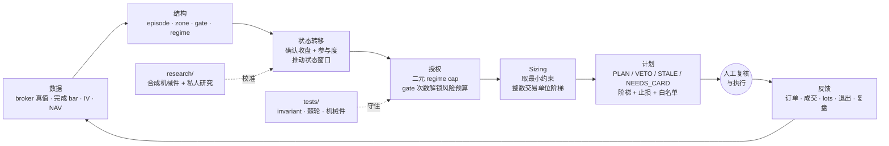
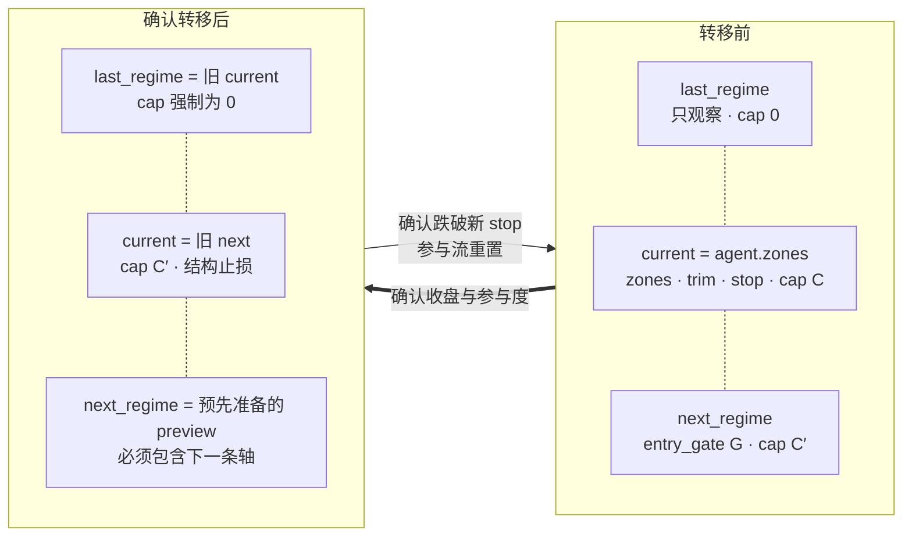
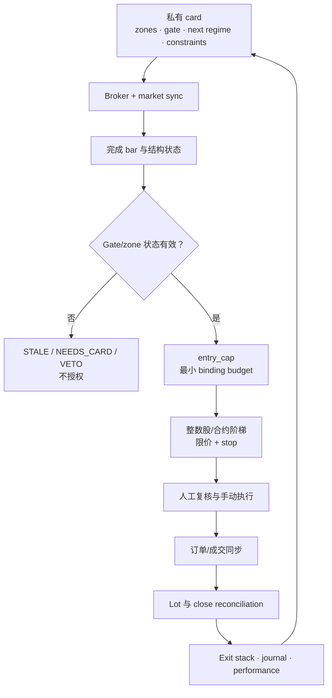
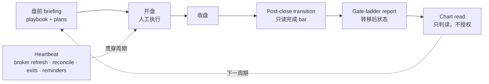
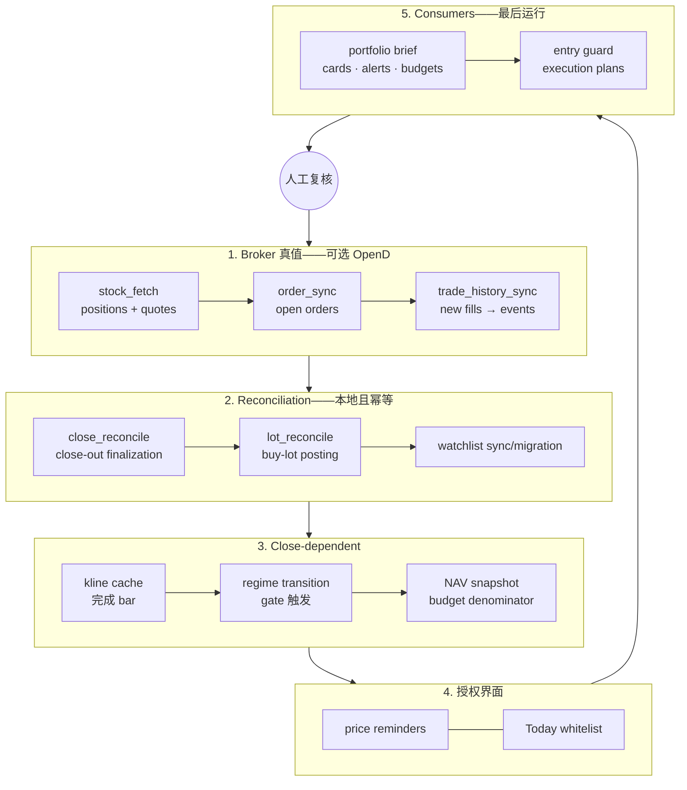

# coreytrading

coreytrading 是一套开源、技术面优先的美股交易运营框架：把 broker 与市场数据转换成确定性的状态、结构授权、风险预算、进出场计划、报告和需要人工复核的订单方案。

> **操作边界：** 机器决定“是否允许、最多多少”，人决定“是否执行”并亲自完成执行。Canonical pipeline 永远不会自动下单。

[English](README.md)

让 AI 从 fresh clone 开始搭建时，先读取中文版 [`AI_BOOTSTRAP_CN.md`](AI_BOOTSTRAP_CN.md)（[English](AI_BOOTSTRAP.md)）。完整项目契约继续保留在 [`CLAUDE.md`](CLAUDE.md)；[`AGENTS.md`](AGENTS.md) 只是 Codex 等 Agent 的兼容入口，不能替代前者。

三类目录承载整个操作模型：

| 目录 | 角色 | 一句话 |
|---|---|---|
| **`quant/`** | 代码 | 分层 package，每条规则只有一个可执行真源，依赖只能单向流动。 |
| **`tests/`** | 可执行规格 | 把规则变成会失败的 invariant，而不是会漂移的 prose。 |
| **`tasks/`** | 定时任务源 | 可复用 prompt 受版本控制；注册到本地 task runner 是另一项独立操作。 |

三者共同服务于一个核心概念：**gate**。

> 本项目是研究与运营软件，不构成投资建议。Broker 凭证和私有状态必须留在本机；所有输出都要验证，执行必须人工复核。

## 十秒看懂



中间的“状态转移 → 授权 → sizing”全部由 gate 驱动。它把市场结构证据和主观执行分开，并让所有下游界面读取同一份机械状态。

---

## 定位——这是什么系统

一句话：**把结构交易的常规工具装配成一台状态机。** 项目不宣称发明 volume profile、摆动结构、ATR 风险归一化、trailing exit、分数 Kelly 上限或预注册；价值在于这些标准件如何连接、分层和验证。

| 标准组件 | 在本系统中的职责 |
|---|---|
| Volume profile、pivot 与摆动结构 | 发现 zone 和状态转移轴 |
| ATR 归一化距离与结构 stop | 把不同价格尺度转换到可比较的风险尺度 |
| 波动率、gross 与单标的上限 | 约束组合和仓位风险 |
| 预注册与负面结果记录 | 防止看到结果后再选择参数 |

框架不推断市场主体意图，也不依赖私有词汇。它只记录可观察的 acceptance、rejection、breakdown 与 recovery，并遵守四条装配原则：

1. Gate 推动整张结构图迁移，不只是修改一个仓位数字；
2. 授权、择时、sizing 和退出保持分层，各有单一真源；
3. 没有代码强制点和会失败测试的规则，不算运营规则；
4. 查看私人结果前先锁定判据，被否决的提案保留在私人研究记录中。

---

## Gate 哲学——系统根基

Gate 是系统的**状态转移轴**：市场反复作出决策的标志性价格位。下降、修复、震荡和上升结构里都可能存在 gate。Zone、regime、cap、阶梯、退出规则、授权清单和运营报告都由它向下派生。

### 一、gate 是被发现的，不是被指定的

标志性价位属于价格序列本身，不是为了方便而挑选的数字。证据可能包括：

- 反复出现的 pivot cluster 与角色互换；
- 有约束力的 supply/demand cluster；
- HVN/LVN 的边界；
- 有意义的 swing high 或 swing low；
- AVWAP 与移动平均线汇聚；
- 历史结构极值或 breakdown 起点。

这带来三项结论：

1. **Gate 与 regime 名称无关。** 分类读取价格历史和结构，而不是 card 的名字。
2. **Gate 与趋势方向无关。** 同一概念可以终止下跌、限制上涨或定义修复 reclaim。
3. **不能为了方便降低证据门槛。** 证据薄弱的线只是 observation，不是授权轴。

Card 没有可辩护的 gate，不只是缺少一个字段，而是这张图还没有完成结构映射。

### 二、gate 是多维确认

任何单一指标都不够。当多个独立维度汇聚在同一价位时，该价位才具备结构意义：

| 维度 | 常见证据 |
|---|---|
| Pivot cluster | Touch count 与 high/low 双向角色互换 |
| 成交量分布 | HVN 边界或 LVN 空洞边缘 |
| 买卖方存在 | Rejection 数量与新鲜度 |
| Dow 结构 | `last_swing_high` 或 `last_swing_low` |
| 动态参考 | MA50、MA200 或 anchored VWAP |
| 历史结构 | 过去极值或 breakdown 起点 |

合成示例可以说明区别：如果某价位同时由 swing high、反复双向触碰、移动平均线和近期失败推动支持，它拥有多维证据；如果某条线位于 volume block 中间，而且 rejection 已陈旧，即使附近有多个指标也不够。

自动 audit 只能提供 advisory：它可以发现遗漏的 swing level 或不合法关系，但不能证明人工结构阅读已经拥有足够多的独立证据。

### 三、gate 是推动状态向上的接口

每张 card 保存一个三状态滚动窗口：

```text
agent.last_regime   current 下方的观察状态；cap 永远为 0
agent.zones         current：zones、trim、no-chase、stop 与 cap
agent.next_regime   gate 确认 reclaim 后进入的状态；可以授予 cap
```

Promotion 移动的是**整张图**，不只是 cap。Stop、no-chase、trim、accumulation zones 和下一条 transition axis 必须一起移动：



没有 `next_regime.entry_gate` 的 card 只能移动一次，因为它没有进入下一状态的准备路径。可执行判据在 `quant/core/structure.py`；current regime 内部的早期信号和历史 repair level 都不能代替下一条转移轴。

### 四、状态转移是机械的

确认规则写在 gate definition 与 transition engine 中：

- 只使用完成的 closing price，绝不使用未完成 intraday bar；
- 使用配置好的确认收盘次数；
- 使用 relative-volume 参与度；
- 仅在明确 domain 内生效的 magnitude fast lane；
- 确定性的 stop 与状态窗口更新。

Transition 不等待人工确认。退出执行与状态转移是两件事：operator 可以不执行订单，但这不会改写市场结构已经发生的变化。

Promotion 后：

- cap、stop、no-chase 和 participation 等机械字段立即生效；
- 临时 zones 可以带 `pending_repaint`；
- repaint 未完成时，`entry_guard` 返回 `NEEDS_CARD`，不授予入场；
- close-dependent stage 只能读取完成 bar。

### 五、gate 是保险，不是 alpha

预注册研究显示了明确取舍：确认可以降低 stop-out 频率、改善左尾，但平均收益会付出 premium。因此 gate 是防御性授权，不是预测超额收益的声明。

直接结果：

- Gate domain 必须窄且明确，不能强加给每个新 position；
- 防止越跌越买依赖 cap 归零，而不是冻结 gate；
- 已 promotion 的 holding 只有通过下一次确认状态转移才能获得 add-on authorization；
- 修改 confirmation 或 stop semantics 前必须重新运行指定研究机械件。

可复用研究机械件保存在 `quant/research/`；私人 protocol、dataset、result 和 ruling 留在 ignored workspace。Live code 永远不能 import research 层。

### 六、gate 与 zone 同生、同死、同锚

Gate 与 zones 来自同一次结构阅读。Zone stale，则 gate stale；其中一项重画时，两者必须共享同一个结构 anchor。

`quant/core/structure.py` 的共享规则强制：

1. **同寿命**——zones stale 意味着 gate stale；
2. **同 anchor**——gate 与 zone anchor 必须在允许容差内一致；
3. **coherence**——向上 gate 必须与 no-chase 和 stop 的关系一致。

重新核实证据不等于重新 anchoring。更新 receipt 或 rejection count 只能改 basis 文本，不能凭空制造新结构 anchor。Next-regime gate anchor 必须由受控更新路径构造，不能手写。

### 七、gate 如何变成风险预算

Gate count 表示当前 participation stream 中真正授予 cap 的向上 transition 次数，不是 fill 次数，也不是每条观察线。Breakdown 或完整 close-out 会重置 stream。

Campaign budget 通过累计 gate ceiling 解锁；当前 exposure 消耗可用余额：

```text
gate count   从 agent.regime_history 中授予 cap 的 transition 推导
budget       当前 gate count 对应的累计 NAV-risk ceiling
conversion   NAV × risk ceiling ÷ stop distance − 当前市值 exposure
stop         最先约束的结构/ratchet/trend line
```

`quant/core/sizing.py` 是单一真源。`sizing.entry_cap()` 在六项约束中取最小值：

1. 当前 regime notional cap；
2. gate risk-budget room；
3. at-risk ceiling；
4. portfolio shock-budget room；
5. gross-exposure room；
6. 当前 buying power。

计划必须报告 binding constraint。名义 regime cap 只是 ceiling，不是 allowance。同一个 sizing function 同时服务 entry plan、authorization list 和运营报告，避免它们静默产生不同数字。

### 八、gate 的结构身份

`quant/core/episodes.py` 的四分类决定 gate 属于哪条结构路径：

| 分类 | 结构问题 | 授权含义 |
|---|---|---|
| Repair reclaim | 价格是否经历实质 breakdown 后重新 reclaim landmark？ | 保险 domain；确认后可以恢复 participation。 |
| Trend continuation | 价位是否属于已经健康的趋势？ | 默认仅 observation，除非 reviewed rule 授予 add-on。 |
| Range boundary | 价格是否在没有 qualifying breakdown 的大结构内旋转？ | 提供结构 context，不自动成为 repair gate。 |
| New-high line | 是否为上方没有结构的历史极值？ | 使用独立证据要求的 breakout context。 |

Classifier 读取 episode 和价格机械件，不读取描述性 card label。

### 九、画 gate 的检查表

接受一条 gate 前：

1. 确定结构分类；
2. 记录至少两个独立证据维度；
3. 不只数 rejection/touch，还要检查其新鲜度；
4. 确认价位位于 boundary，而不是 volume block 中间；
5. 定义 close count 和 participation requirement；
6. 定义 destination regime、cap 和 structural stop；
7. 同时构造下一状态 preview；
8. 让 gate 和 zones 锚定在同一 observation set；
9. 运行 `gate_audit` 和相关 schema check；
10. 未解决证据必须进入 review，不能变成 authorization。

### Gate 在代码中的位置

| 关注点 | 单一真源 |
|---|---|
| Episode 与结构分类 | `quant/core/episodes.py` |
| Gate/zone 寿命与 anchor | `quant/core/structure.py` |
| 技术证据 | `quant/core/technical.py`、`quant/core/patterns.py` |
| Transition 机械件 | `quant/decision/regime_transition.py` |
| Entry authorization 与计划 | `quant/decision/entry_guard.py` |
| Sizing 与 gate budget | `quant/core/sizing.py` |
| Exit stack | `quant/decision/exit_guard.py` |
| Gate audit 与报告 | `quant/report/gate_audit.py`、`quant/report/gate_ladder_report.py` |

---

## 运作流程——一笔交易如何走完生命周期



三个原则保证闭环一致：

1. Card construction 属于 judgment，execution 属于人工；state update、guard 和 reconciliation 属于机械件。
2. `entry_cap` 是所有下游界面的 sizing 漏斗。
3. Close 不是数据生命周期终点：reconciliation 可以把已 review 的 card 送回 candidate pool，等待未来 campaign。

### 一个运营日如何运行



顺序是设计的一部分：transition 必须先于 ladder report，chart interpretation 必须读取转移后状态。准确 schedule 属于 operator-local 配置，必须考虑 timezone、exchange calendar 和 daylight-saving change。

---

## `quant/`——代码

依赖只能向下。上层可以 import 下层，反向禁止。Package 深度固定为 `quant/<layer>/<module>.py`，并由测试强制。

```text
  ops          编排 / 通知
   ├── report  读时报告；不创建 canonical state
   ├── journal 结构化 ledger 写入
   ├── decision 机械 guard 与 transition
   │    ├── options  合约级参数
   │    └── risk     sizing 与集中度辅助
   ├── sync    broker 真值 ↔ 私有 state
   ├── data    外部世界 → 私有 cache
   └── core    纯共享库与可执行真源

  research     历史验证旁路；live code 禁止依赖
```

### `core/` 回答“谁说了算”

| Module | 单一真源 |
|---|---|
| `sizing.py` | Regime cap、gate budget 与整数交易单位阶梯 |
| `structure.py` | Gate/zone 寿命、anchor 与 card regime derivation |
| `episodes.py` | Breakdown 机械件与结构分类 |
| `holdings.py` | 从 broker quantity 推导 holding identity |
| `book.py` | NAV、单票 shock 与 gross book usage |
| `technical.py` | Indicator 与 volume-profile 数学 |
| `patterns.py` | Pattern classifier |
| `earnings.py` | Event-day sizing 与 redraw SLA |
| `schema.py` / `io_json.py` | Validation、locking 与 atomic write |

详细 import、bootstrap 和 path 规则见 [`quant/README.md`](quant/README.md)。

### 运行

使用 bootstrap 指南创建的隔离解释器：

```bash
python -m quant.ops.pipeline --mode briefing --json
python quant/decision/entry_guard.py --json
python quant/report/portfolio_brief.py --read-only --json
```

交互式检查 brief 时使用 `--read-only`；默认 operations mode 可能消耗 alert-cooldown state。

---

## `tests/`——可执行规格

没有进入 executable behavior 的规则会静默漂移。因此 tests 镜像应用分层，也守住仓库本身。

```bash
python -m pytest -q
python -m pytest tests/core -q
python -m pytest --collect-only -q
```

不要把收集到的测试数量抄进文档；需要时现查。

### 仓库守卫

| Guard | 钉住什么 |
|---|---|
| `tests/test_layering.py` | 单向依赖、固定深度、bootstrap 形式与 research 隔离 |
| `tests/test_module_coverage.py` | `quant/<layer>/` ↔ `tests/<layer>/` 镜像和只减不增的 `UNTESTED` 棘轮 |
| `tests/test_repo_references.py` | 维护范围内 code/docs 的内部路径真实存在；可选本地 task 副本与真源一致 |
| `tests/test_constant_pins.py` | 有意跨 module 复制的常量保持一致 |
| `tests/test_live_data_isolation.py` | 离线测试不会静默读取私有 live data |

Architecture 和 coverage guard 必须做 mutation test：逐类注入代表性违规，确认每项约束确实会失败。

### `tests/research/`——真数据前的合成验证

Research 会改变 live authorization、stop 和 budget 参数。纪律是：

- 预注册 definition、timing、statistics 和 verdict rule；
- 实现和机械件测试阶段只用 synthetic data；
- 机械件锁定后才运行经过授权的历史数据；
- 用 rulings ledger 保存 adopted、rejected 和 scoped finding。

Degrees-of-freedom audit 与 `UNTESTED` 是棘轮，不是文档数字。应读取 executable baseline，不能把数量抄进 prose。

---

## `tasks/`——可复用定时任务 prompt

`tasks/` 是版本控制下的 prompt 真源，但它不能证明本地已经注册任何任务。

| Task | 用途 |
|---|---|
| `heartbeat` | 周期性 broker refresh、reconciliation、reminder 与 risk/exit patrol |
| `overnight-briefing` | 盘前 macro、portfolio 和 entry-plan briefing |
| `postclose-transition` | 应用收盘确认的 regime transition |
| `gate-ladder-report` | 渲染转移后的 gate ladder |
| `chart-read` | 对完成 bar 做结构判读，授权效力为零 |
| `weekly-portfolio-review` | 复核 exposure、process、data quality 与 rule adherence |

三条规则：

1. 先修改 repo prompt，再更新经过授权的本地 task copy。
2. 写入 prompt file 不等于注册任务；必须检查 runtime registry。
3. Schedule 必须复核 timezone、exchange calendar 和 daylight-saving change。

本地 task-copy reconciliation 通过 `tests/test_repo_references.py` 中说明的环境变量显式启用。公开 CI 永远不能依赖某个用户的 task registry。

---

## Runtime 闭环

`quant/ops/pipeline.py` 是 canonical orchestrator。Stage order 属于代码，不能复制成多份 prose。



顺序约束：

- fills 必须先于 lot 和 close reconciliation；
- NAV 必须先于依赖预算的报告和授权界面；
- 报告必须在 state collection 后运行，不能读取半成品 snapshot。

| Mode | 角色 |
|---|---|
| `heartbeat` | Broker refresh、reconciliation、reminder、whitelist 与 exit patrol |
| `briefing` | 完整运行，包括完成 bar、transition、snapshot、drift 和 entry plan |
| `postclose` | 为盘后状态准备的精简 completed-bar chain |

### 常驻基础设施告警

Brief 会显式报告容易静默失效的类别，包括：

- ledger/broker 的 lot 或 quantity drift；
- gate/zone anchor desync；
- 缺少 next gate 或 zone anchor；
- event calendar 或 event 后 card stale；
- option exposure 缺少 underlying card；
- fill 缺少 authorization stamp；
- card promotion 被拒绝；
- OpenD 不可用。

多个 operations mode 共享 cooldown state，保证同一条件全局去重。

---

## 状态与数据所有权

私有 runtime state 遵循 [`trade/README.md`](trade/README.md) 下的契约。

| Store | 所有权 / 语义 |
|---|---|
| `trade/us_stock/holding/state/positions.json` | Position-card 真值：broker block、agent-owned structure、lots 与 pending orders |
| `trade/us_stock/holding/state/watchlist.json` | Candidate card 与已 review 的 entry analysis |
| `trade/us_stock/holding/state/exit_guards.json` | Script-owned ratchet、trail 与 re-entry state |
| `trade/us_stock/holding/events/` | Append-only fills、decisions 与 NAV events |
| `trade/us_stock/market/` | 私有/生成 market cache 与 licensed data |
| `trade/us_stock/knowledge/` | 私有 research card 与 evidence |
| `trade/us_stock/strategy/` | 根据显式输入构建的用户专属 policy |

Broker-derived block 只允许 `quant/sync/` 写入。Paths、schemas、locked atomic write、holding identity、structure 和 sizing formula 都在 `quant/core/`。

公开 `trade/` 只包含 README 契约和合成 `*.example.*` schema。严禁提交已填写的 runtime file。

---

## Research 工作区

`quant/research/` 是隔离的公开研究脚手架，只保存可复用验证机械件。私人研究产出 statistics 而不是 action，live code 禁止 import research 层。

- 结果产生前先预注册判据；
- 授权历史数据运行前，先用 synthetic test 验证机械件；
- [`quant/research/README_CN.md`](quant/research/README_CN.md) 定义 AI 搭建流程和公开/私人边界；
- 已填写的 preregistration、dataset、report、chart、ruling 和 backlog 都必须保持为 ignored private artifact；
- 提议修改参数前，检查 live parameter，并针对其 domain 重新运行获准的私人研究。

---

## 系统边界

coreytrading 是技术面优先、规则驱动、半自动化的框架，不是端到端 ML strategy，也不是 autonomous execution bot。

- 价格结构驱动 `zone / gate / regime / cap` 授权。
- Fundamentals、research、earnings 和 macro 主要是 information input；明确的 event-risk rule 可以调整 size。
- Hot path 分类当前状态，不产出统一 return forecast。
- Portfolio construction 基于 constraint 和 budget，不是 covariance optimizer。
- 系统产出 limit、unit、stop、option parameter、alert 和 authorization list。
- 执行保持人工或走单独审批；live pipeline 永远不会调用内置下单脚本。
- 订单与成交可以同步回 state、ledger、journal 和 performance review。

真实持仓、watchlist、fills、journal、active-universe cache、research、strategy、credential 和 account identifier 都有意从公开仓库移除。

---

## 优势与局限

### 架构试图解决的问题

| 优势 | 架构依据 |
|---|---|
| 一个数字只有一个来源 | 入场额度统一经过同一约束漏斗，计划、报告、提醒备注和授权清单共同复用。 |
| 规则能够明确失败 | 分层、模块覆盖、路径有效性、state schema 与运营顺序都由可执行测试守住。 |
| 把静默失效当产品风险 | 基础设施告警、dead-man state 和明确 dry-run 让数据缺失与自动化中断可见。 |
| Research 不能直接控制 live path | Research 层隔离，合成机械件先测试，live module 禁止 import research。 |
| 代码缺陷不能直接变成订单 | Canonical pipeline 只生成方案，不提交订单。 |

### 它解决不了的问题

- 不预测收益，不产出统一 alpha score，也不做 covariance optimization；
- 日线确认与周期巡逻天然无法及时处理 intraday move 和 gap；
- 结构 card 仍需要判断；自动启动 AI 分析不等于分析必然正确；
- 小账户或高价 instrument 会受到整数交易单位的粗粒度影响；
- Broker 集成本身不可直接移植；换 broker 通常需要重做 `quant/sync/` 边界；
- 公开仓库不含私人 dataset、live performance history，也不证明默认参数适合其他用户。

---

## 适用场景与人群

本框架更适合日线或周线 swing workflow：operator 能读 Python、持续维护结构 card、接受机械 VETO，并让最终执行保持人工复核。

它不适合高频或日内交易、自动下单、市场中性组合优化、signal-to-buy 黑盒，也不适合希望获得收益预测或宣传胜率的人。

---

## 复用前须知

1. 在针对自己的账户、instrument 和亏损承受力完成论证前，把所有风险常量视为 placeholder；
2. 只根据 `trade/` 的 example 生成 ignored runtime file，严禁提交真实持仓、账户历史或 credential；
3. Session 内查看报告使用 `--read-only`，state writer 与 detached agent 先走 dry-run；
4. 修改会动钱的参数前重跑对应私人研究，并在查看结果前锁定判据；
5. 在真实 runtime registry 中核实定时任务；磁盘上存在 prompt file 不代表已注册或会触发；
6. Close-dependent transition 只能使用 completed bar，每条告警链都要做端到端验证。

---

## 免责声明

本仓库是软件与研究基础设施，不构成投资建议或投顾服务。交易可能导致重大或全部本金损失。历史与回测结果不保证未来表现；公开脚手架有意不包含业绩声明，也不推荐交易任何 instrument。

代码按 MIT License 原样提供，不含担保。程序缺陷、陈旧数据、broker 服务不可用、task 配置错误或结构分析错误都可能造成财务损失。任何把框架连接到真实资金的人，都必须自行验证，并自行承担当地法律、税务、broker 条款与每次执行决策的责任。

---

## 快速开始

Python 要求和依赖 pin 以 `pyproject.toml` 为准。

```bash
python3 -m venv .venv
. .venv/bin/activate
python -m pip install -e '.[dev]'
python -m pytest -q
```

Broker-connected workflow 是可选能力：

```bash
python -m pip install -e '.[broker]'
cp .env.example .env
```

然后遵循 [`AI_BOOTSTRAP_CN.md`](AI_BOOTSTRAP_CN.md)、[`opend/README.md`](opend/README.md) 和 [`.claude/rules/tools-environment.md`](.claude/rules/tools-environment.md)。真实值只能保存在本机。

## License

MIT。第三方集成保留各自声明与条款；使用内置 OpenAPI skill 前请阅读 Moomoo/OpenD 风险提示。
