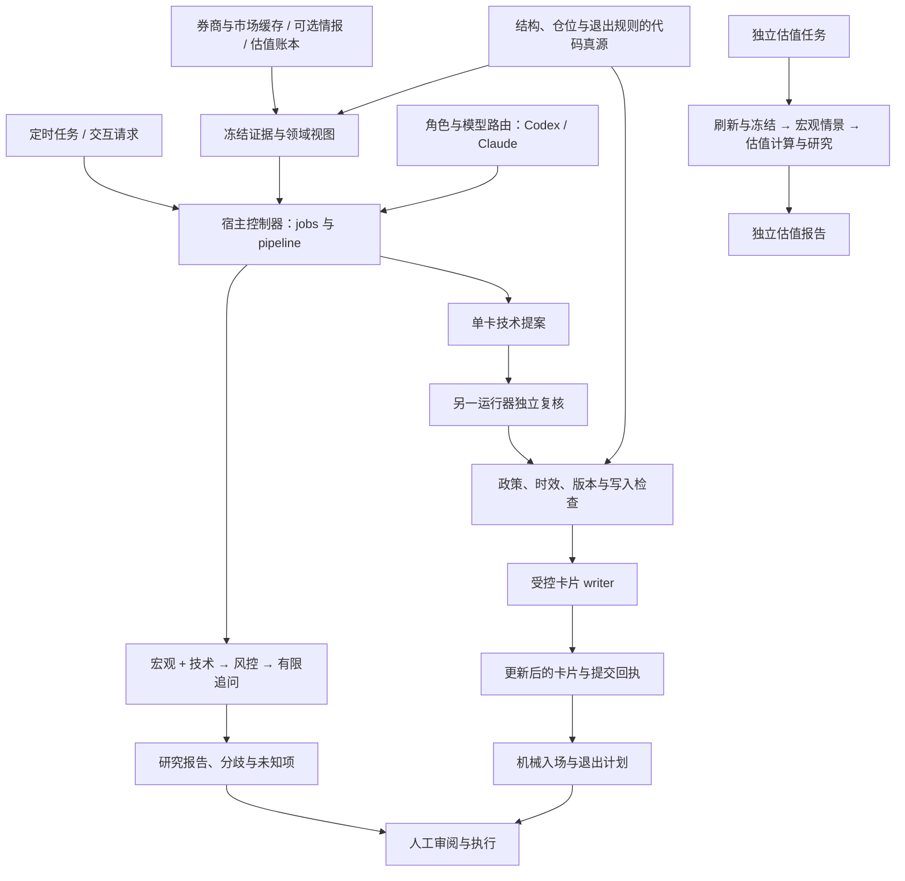

# coreytrading

以**领域 Agent、可替换模型运行器和可执行交易规则**为基础的美股交易运营系统。Codex 与 Claude 协作研究，宿主控制器校验结果并提交通过复核的卡片更新，订单由人工执行。

[English](README.md) · [Agent 运行手册](agents/README.md) · [代码架构](quant/README.md) · [定时任务](tasks/README.md) · [业务资料](trade/README.md) · [AI 搭建指南](AI_BOOTSTRAP_CN.md)

所有模型共用的项目合同是 [CLAUDE.md](CLAUDE.md)；不会自动发现该文件的编码 Agent 从 [AGENTS.md](AGENTS.md) 进入。

交易范围为美股与现有美股期权流程。跨资产宏观数据只用于环境观测与研究输入，不因此成为额外的交易市场。

## 架构

系统按领域划分职责。每个角色的方法、证据要求和输出权限，与它使用的模型分别定义。将某个角色从 Codex 换成 Claude，只需调整路由；角色契约和交易规则继续生效。



模型负责解释证据和跨领域协作，Python 负责取数、金额计算、运行额度、结果校验和状态写入。Worker 只接收冻结输入并返回结构化 JSON，没有工作区访问、券商调用、消息发送或下单权限。

## 默认 Agent 分工

| Agent | 运行器（运行时点） | 独立复核运行器 | 职责 |
|---|---|---|---|
| **宏观** | **Codex**（周复盘 / 估值日更） | Claude | 解读既有宏观证据、相位与不确定性，提供环境先验；每日简报直接读情报流程发布的 `macro/current.json` |
| **技术分析** | **Claude**（每日唯一模型角色；同收盘同卡片版本复用 run） | Codex | 判读价格结构、gate 与 zone，提出单卡更新提案 |
| **风控／仓位管理** | 每日 = 代码渲染（`quant/report/risk_receipt.py`）；周复盘 = **Claude** | Codex | 检查全组合敞口、购买力、退出约束和机械 sizing 收据 |
| **估值** | **Codex**（独立日更） | Claude | 解读财务报表、估值账本、情景和隐含预期 |

[agents/routing.json](agents/routing.json) 是配置真源。领域角色、运行器、模型提供方和模型 ID 是四个概念：宏观是角色，Codex CLI 是运行器，OpenAI 是模型提供方，某个具体 GPT 版本才是模型。路由 v2 通过 `model_profiles` 集中定义具体模型，各角色引用主用 profile 与独立复核 profile。

| 模型 profile | 首选模型 | 次选模型 | 明确指定的 effort |
|---|---|---|---|
| Anthropic / Claude Code | `claude-fable-5-1` | `claude-opus-5` | `xhigh`，即 extra high |
| OpenAI / Codex CLI | `gpt-6-astra` | `gpt-5.6-sol` | `high` |

主用、备用和复核调用都明确传入 model 与 effort，不继承桌面对话中选中的模型。回执分别保存请求参数和 CLI 元数据实际报告的模型 ID；未报告或报告多个模型时，如实记录，不用请求值代替确认结果。请求复核时才调用 reviewer；卡片提交是否需要独立批准由 `autopaint.review` 决定。

模型有依据地弃权时，系统保留弃权结果。当前生产配置关闭模型备用与独立复核：失败保留为失败，不转交其他模型。控制器保留可配置的故障接管与复核能力，供显式重新启用。明确的 session 额度错误会跳过本次运行中该运行器的其余模型。复核选择与实际研究运行器相反的一方；该方不可用时研究保留为 needs_review，不能提交。复核不批准不触发换模型重问。后续模型迭代按[模型维护规则](agents/MODEL_POLICY.md)核验版本、完成验证后更新。

## Agent 如何协作

1. **捕获证据。** 宿主读取既有状态与缓存，记录 owner、时间和内容 hash，冻结共享快照及各角色视图。捕获不等于刷新，缺失和失效信息会保留。
2. **并行研究。** 交易流程中的宏观与技术角色分别分析自己的领域输入；独立估值流程按宏观情景、宿主计算、估值研究的顺序执行。输出区分事实观察、假设、风险和未知项，引用绑定捕获时的原始证据。
3. **组合复核。** 风控读取自己的原始输入与本轮宏观、技术报告。风控视图覆盖全部受管持仓，包括期权自身退出规则与可用 Greeks；金额来自既有机械计算。
4. **定向追问。** 跨领域请求按接收角色合并，最多追加一轮，未解决的问题留在记录中。同一结论经另一模型转述，不增加独立证据。

当前配置允许单次 workflow 最多 2 个并行调用、8 次模型调用，不自动追问。宿主另设所有任务共享的上限：原生调用并发最多 2 个，滚动一小时内最多 12 次。备用同样消耗预算，并发排队有超时。这些额度约束本系统的工作量，不代表任一模型账户的剩余额度或费用。

`execution_transport = desktop` 时宿主不启动模型 CLI：数据包写入 `var/agent-runs/desktop/`，各运行器的 Desktop 会话按 [tasks/desktop-research.md](tasks/desktop-research.md) 领取、作答并提交；编排、冻结证据、受控提交与 applied 回执仍归宿主。每日循环只跑技术角色，风控收据由代码渲染，三角色工作流只在周复盘。

## 复核后的自动写卡

当前配置开启 `autopaint.enabled` 与 `autopaint.apply`，`autopaint.review=false`：技术提案通过宿主证据、revision 与机械政策检查后写入，不做第二模型复核。新研究记录绑定该复核政策，旧记录默认仍要求复核；回执标明模型复核「不需要」，而不是「已批准」。符合条件的缺卡、失效卡可进入自动更新流程。组合报告本身不写卡；每个目标通过独立单卡任务生成技术提案，是否做独立模型复核由宿主政策决定。

宿主检查原始证据、结果与政策绑定、有效期、参数白名单和目标卡当前版本，保存原卡备份及提交准备回执，再调用既有的[卡片 writer](.claude/skills/trading-analysis/scripts/update_position_zones.py)。券商字段、lots、在途订单和绑定约束继续受到保护。

| 结果 | 含义 |
|---|---|
| `succeeded` | 模型研究结果通过契约校验，不证明已经写卡 |
| `needs_review` | 证据、复核或提交检查存在待处理问题 |
| `partial` | 任务已结束，仍有失败或待办事项留在记录中 |
| `applied` | 目标卡片更新具有已确认的提交回执 |

将 `autopaint.apply` 改为 false，自动写卡流程回到研究与预览。自动提交前会再次检查开关，包括已经启动但尚未提交的任务；关闭开关不撤销已经完成的写入。通过 `submit --apply` 明确选择单笔提案，是另一个人工提交入口，具体行为见[运行手册](agents/README.md)。

如果写入结果不确定，系统用准备回执中的 before/after hash 核对当前卡片。恢复只更新收据，不盲目重试写卡。运行产物、卡片备份与健康事件共同保留调查所需的证据。

## 日常运行

任何能让编码 Agent 执行 prompt 的调度器（桌面任务运行器、配合 CLI Agent 的 cron）都可以触发六个交易任务，Python 控制器独立于调度器选择各领域使用的运行器。

| 任务 | 领域工作 |
|---|---|
| `heartbeat` | 券商与状态同步、机械风控和退出告警、健康检查、非阻塞缺卡派发 |
| `overnight-briefing` | 刷新每日输入，运行技术角色（同收盘同卡片版本复用）并附代码渲染风控收据，处理重画队列并生成入场计划 |
| `postclose-transition` | 先评估退出，再执行完整收盘后的机械转移，渲染转移达标收据，运行技术研究并附代码渲染风控收据，处理重画 |
| `gate-ladder-report` | 等待同交易日 postclose 完结后，输出机械 gate 阶梯表 |
| `chart-read` | 代码渲染两种可交易形态（抄底 / 趋势确认）已形成或即将形成的清单；零模型调用 |
| `weekly-portfolio-review` | 用既有绩效、宏观与技术证据完成组合风控复盘，NAV 周变剔除外部现金流 |

独立的 `valuation-daily` 任务（[tasks/codex/valuation-daily.md](tasks/codex/valuation-daily.md)）自行刷新数据并运行宏观情景与估值链，报告归档在 `var/valuation-daily/`。盘前与周复盘不运行估值角色。

盘前与盘后流程的关键顺序是：

```text
刷新券商与市场输入
→ 按原卡评估退出
→ 执行机械 regime 转移
→ 领域研究与复核后的卡片更新
→ 刷新提醒线和入场授权组
→ 生成入场计划
```

同步重画阶段每轮至少处理五张卡，队列更长时按 ⌈N/2⌉ 取整以保证两轮排空，余下目标留在待办中。缺卡检测也可以后台派发，使用同一个单卡控制器与全局额度。

[market_sessions.py](quant/core/market_sessions.py) 通过 XNYS 日历处理休市、半日市和夏令时。每份 prompt 先跑 `quant/ops/agent_jobs.py due --kind <kind>`；postclose、ladder、chart 分别在实际收盘后 10、20、35 分钟开放运行窗口，统一在收盘后 60 分钟截止。时间放行与上游任务完成是两项独立检查。固定版本的日历当前覆盖 2000–2028 年；数据不可用或超出支持范围时停止判断，不退回按星期几猜。

[tasks/](tasks/) 保存版本管理的提示词。live 副本、应用内注册和实际完成回执是三种不同证据；具体时刻与同步流程统一维护在 [tasks/README.md](tasks/README.md)。

## 交易规则与数据所有权

核心策略仍是技术面优先的趋势跟踪。**Gate** 标记结构状态转移，**zone** 描述状态内的参与区间，**cap** 是授权上限。这三个概念各有含义，由代码执行约束。

| 判定或数据 | 单一真源 |
|---|---|
| 价格结构、regime 与绑定止损 | [structure.py](quant/core/structure.py) 与 [regime_transition.py](quant/decision/regime_transition.py) |
| Gate 预算、敞口与可执行仓位容量 | [sizing.py](quant/core/sizing.py) 与 [book.py](quant/core/book.py) |
| 入场计划与机械退出 | [entry_guard.py](quant/decision/entry_guard.py) 与 [exit_guard.py](quant/decision/exit_guard.py) |
| 券商数量、成交与在途订单 | `quant/sync/`；Agent 不写券商真值 |
| 技术卡片提案 | 技术角色、独立复核及受控 writer |
| 宏观与估值证据 | 信息层上下文，不能覆盖价格结构授权或退出规则 |
| NAV 变动与外部现金流 | [nav_report.py](quant/report/nav_report.py) 读取 [cash_flow_sync.py](quant/data/cash_flow_sync.py) 维护的现金流账本；出入金不是盈亏 |
| 策略研究与规则变更 | [策略 schema](trade/strategy/README.md)（私有规则是被忽略的副本）、[研究脚手架](quant/research/README.md) 及适用的验证研究 |

风控 Agent 解读机械收据，不另造 sizing 公式。候选容量共享组合约束，不能相加成一批订单的预算。购买力、工具身份或证据未知时，继续报告未知。新闻与宏观采集属于可选、独立维护的情报工作流；其发布数据位于 `trade/intelligence/`（本仓只含 README 与合成示例），交易角色只读消费已有归档，缺失时优雅降级。

## 仓库结构

| 位置 | 内容 |
|---|---|
| [CLAUDE.md](CLAUDE.md) / [AGENTS.md](AGENTS.md) | 对所有模型生效的项目合同／兼容入口 |
| [AI_BOOTSTRAP.md](AI_BOOTSTRAP.md) / [AI_BOOTSTRAP_CN.md](AI_BOOTSTRAP_CN.md) | 编码 Agent 的 fresh clone 搭建指南 |
| [agents/](agents/) | 领域方法、角色契约、路由和运行手册 |
| [quant/](quant/) | 宿主控制器、数据同步、机械决策、估值和报告 |
| [tests/](tests/) | 合成数据机械验证、契约、隔离和仓库检查 |
| [tasks/](tasks/) | 定时任务提示词真源与部署说明 |
| [trade/](trade/README.md) | AI 初始化合同：下表六个数据目录的 README 与合成 `*.example.*` schema；私有卡片、持仓、事件、缓存、情报数据与规则是被忽略的副本 |
| `var/` | 被忽略的私有运行状态：组合锁、情报 claim 与投递去重、Agent 运行／额度／租约、独立估值运行 |
| `tmp/` | 被忽略的临时输出与 heartbeat 冷却状态 |
| `.claude/` | 专项规则、skills 与宿主集成 |

`trade/` 的六个目录直接位于根下，路径由 [quant/core/paths.py](quant/core/paths.py) 统一定义：

| 目录 | 内容 |
|---|---|
| `trade/portfolio/` | 当前持仓与候选、成交/NAV/现金流账本、评分、人工日志和派生观察 |
| `trade/market/` | 行情、财报与原始市场输入；可重拉缓存和历史快照分别保留 |
| `trade/intelligence/` | 新闻来源、宏观快照、事件计划/结果与发布报告 |
| `trade/valuation/` | 人工估值输入、预测账本与校准记录 |
| `trade/strategy/` | 交易规则与方法合同 |
| `trade/knowledge/` | 知识资料与冻结只读的研报库 |

组合派生判断在 `portfolio/observations/`，共享写入锁在 `var/portfolio/.state.lock`。历史持仓 Git 读取与旧情报引用由代码兼容，已发布证据保留原文。宏观/事件量化区分原始证据、可知时点特征、结果标签与实验；当前没有预建空的研究子系统。

Python 依赖继续分层：`ops` 编排下层，共享契约与数学集中于 `core`，研究代码不进入实时依赖链。完整规则见 [quant/README.md](quant/README.md)。私有状态和模型产物不作为可复用示例或公开发布材料。

## 开始使用

Python 版本与依赖 pin 以 `pyproject.toml` 为准：

```bash
python3 -m venv .venv && . .venv/bin/activate
python -m pip install -e '.[dev]'
python -m pytest -q
```

参考部署环境使用 macOS、已登录的 Claude Code 与 Codex CLI、用于券商与数据同步的 Moomoo OpenD，以及隔离的 Python 环境；当前 Codex runner 的隔离实现依赖 macOS。环境细节见 [tools-environment.md](.claude/rules/tools-environment.md)，凭据只放在 `.env` 与本地凭据存储。完整搭建流程，包括从 `trade/` 下的示例构建私有工作区，见 [AI_BOOTSTRAP_CN.md](AI_BOOTSTRAP_CN.md)。

在仓库根目录运行以下命令，可查看配置、输入元数据、调度资格与健康状态，不调用模型：

```bash
python3 quant/ops/agent_runtime.py roles
python3 quant/ops/agent_inputs.py --scope portfolio --json
python3 quant/ops/agent_jobs.py due --kind postclose
python3 quant/ops/agent_health.py
python3 quant/ops/agent_doctor.py --json
```

在交互会话中查看缓存简报，使用只读 pipeline：

```bash
python3 quant/ops/pipeline.py --mode briefing --read-only --json
```

该命令只渲染缓存，跳过同步、转移、通知、journal、Agent 调用和 entry 阶段，不会刷新数据。

要基于已有输入发起宏观、技术与风控组合研究：

```bash
python3 quant/ops/agent_jobs.py run --kind weekly --json
```

这条命令会调用模型并保存私有研究产物，不提交卡片更新。单卡研究、提交预览、明确写入和不确定结果恢复，参阅 [Agent 运行手册](agents/README.md)。

## 验证与扩展

```bash
python -m pytest -q
python -m pytest --collect-only -q
```

测试覆盖角色与 provider 互换、权限契约、证据绑定、过期、并发、独立复核、受控写入和恢复；仓库检查还约束依赖方向、模块覆盖、文档路径有效性、`trade/` 脚手架与公开脱敏。

默认测试跳过显式标记的真实数据与宿主状态审计，跳过不算通过；pytest 本身也不提供网络隔离。模型一致或测试通过，不证明研究质量和投资收益。

扩展方式：

- **调整模型分工：** 修改 [routing.json](agents/routing.json)，用 `agent_runtime.py roles` 校验。
- **调整领域方法：** 修改角色定义及证据契约，保持机械规则的代码真源。
- **接入新 provider：** 实现运行器和路由校验，验证同一套契约与隔离边界。
- **增加角色或权限：** 修改显式角色 schema、workflow 和测试；新增 Markdown 文件本身不会注册角色。
- **修改交易机制：** 遵循 [CLAUDE.md](CLAUDE.md) 与相应研究验证要求。

## 免责声明

本仓库是软件与研究基础设施，不是投资建议或投顾服务。交易可能造成重大甚至全部损失；历史或回测结果不保证未来表现，公开脚手架有意不包含任何收益声明或对任何标的的交易建议。把本框架接入真实资金的人，自行负责独立验证、当地法律与税务要求、券商条款以及每一个执行决定。

## 许可

[MIT](LICENSE)。本仓记录一套交易流程，研究与计划不构成投资建议或收益保证。
