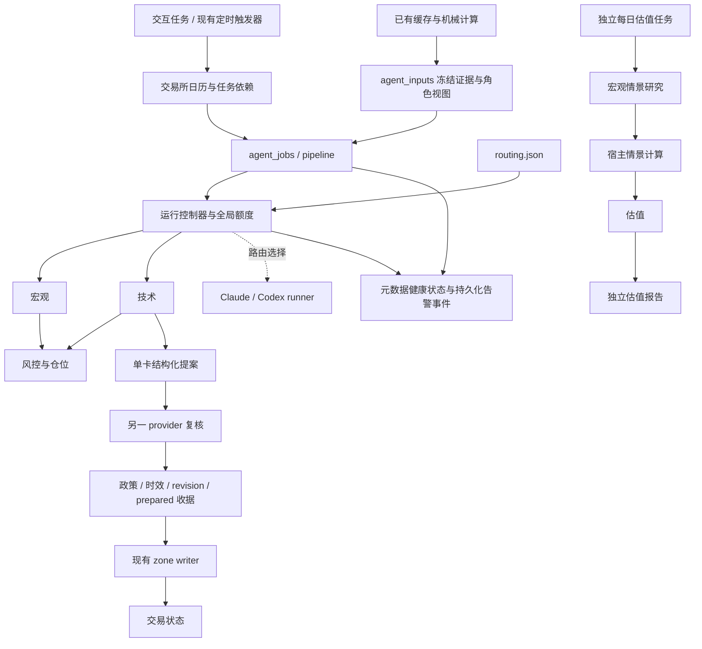

# 领域 Agent 运行手册

宏观、技术分析、风控与仓位、估值四个角色通过统一契约协作，生产任务由宿主控制器编排。角色定义与模型选择分离：`routing.json` 决定 Claude/Codex 路由，runner 处理各自 CLI，既有机械计算与受控 writer 决定实际权限。代码具备研究、复核、受控写卡和运行恢复能力；自动写入开关以 `routing.json` 的配置为准；本手册不记录具体验收日志。

## 架构与权限

市场情报采集任务是四个冻结输入角色的上游，不是 macro worker 的另一种运行模式。它是用户自有的可选工作流，本仓不包含其采集与投递流程：证据与发布数据在 `trade/intelligence/`（公开仓只有 README 与合成示例），共用方法（若配置）在 `agents/methods/`，缺失时角色输入把它们记为 `optional_methods_missing`，不臆造。



| 对象 | 职责 | 实现 |
|---|---|---|
| Role | 方法、证据要求、输出权限 | `roles.json`、四份角色 Markdown、`quant/core/agent_contracts.py` |
| Route | 主模型运行器、备用、复核、超时与额度 | `routing.json` |
| Inputs | 读取已有来源、计算机械收据、冻结共享与角色视图 | `quant/ops/agent_inputs.py`、`quant/ops/agent_evidence.py` |
| Runner | CLI、登录复用、进程隔离、结构化返回、用量 | `quant/ops/agent_runners.py` |
| Controller | 幂等、租约、结果校验、复核与提交收据 | `quant/ops/agent_runtime.py` |
| Workflow | 按 trading / valuation / full 限定角色、最多一轮追问 | `quant/ops/agent_workflow.py` |
| Jobs | briefing/postclose/weekly/chart 与单卡受控重画 | `quant/ops/agent_jobs.py` |
| Submit | 白名单、独立复核、时效、卡片 revision、旧 writer | `quant/ops/agent_submit.py` |
| Health | 全局额度、进程与业务租约、健康扫描、告警与恢复记录 | `quant/ops/agent_health.py` |
| Calendar / Dependency | 交易所时段与同 session 上游完结屏障 | `quant/core/market_sessions.py`、`quant/ops/agent_dependency.py` |

四个 worker 只能消费 prompt 中的冻结证据并返回 JSON，不能直接读写工作区、调用券商、启动命令、发送消息或下单。技术角色可提出卡片更新；宏观、风控、估值为 `analysis_only`，proposal 必须为空。股数、cap、退出规则由已有机械模块计算；宏观与估值只提供 FYI，缺少机械收据时必须报告 unknown。

宿主显式附上项目合同、角色规则及引用的方法合同；技术角色还收到与提交边界一致的参数白名单。文档中的命令仅解释方法，不授权 worker 执行。Claude 使用无工具 safe mode；Codex 使用隔离配置、macOS 沙箱及限定模型域名的 TLS 代理。认证由原生 CLI 使用，宿主代码不读取或回显 token；runner 在 prompt 输入前登记进程组，登记失败立即终止。CLI 二进制解析顺序 = `CLAUDE_BIN` / `CODEX_BIN` 显式路径（无效即失败，不回落）→ PATH → 已知安装位置（Codex 含 ChatGPT.app 内置副本及其 plugin appserver 缓存；codex 可能不在定时任务的 PATH 上（例如只随桌面应用安装），靠后者解析）。`agent_doctor.py --json` 的 `runners` 段只按路径报告解析结果，不执行 CLI，不证明登录、版本或参数支持。

## 路由与运行额度

默认路由为混合协作，任一角色都可以单独切换 provider：

| 角色 | 主运行器 | 独立复核运行器 |
|---|---|---|
| 宏观 | Codex | Claude |
| 技术分析 | Claude | Codex |
| 风控与仓位 | Claude | Codex |
| 估值 | Codex | Claude |

这里的 Codex / Claude 分别指 Codex CLI / Claude Code 运行器。当前路由使用 v2：`model_profiles` 定义运行器、首选／次选完整模型 ID 和 effort；角色通过 `profile`、`reviewer_profile` 引用主用与复核配置。兼容的内部展开结构仍用 `provider` 表示运行器键名；`agent_runtime.py roles` 展示的是展开后的各端点，便于核对实际参数。

| profile | 运行器 | 首选 | 次选 | effort |
|---|---|---|---|---|
| `anthropic` | `claude` | `claude-fable-5-1` | `claude-opus-5` | `xhigh`（extra high） |
| `openai` | `codex` | `gpt-6-astra` | `gpt-5.6-sol` | `high` |

生产主用、备用与复核端点均明确指定模型与 effort。Claude 传入 `--model` 与 `--effort`；Codex 传入 `--model` 与 `--config model_reasoning_effort=...`。继承环境中的模型／effort 覆盖变量会清除，不使用当前桌面对话或用户配置推断研究模型。旧版 v1 配置仍可读取，但 v2 profile 必须提供非空模型和支持的 effort。

回执的 `model` 保留请求值语义，新增 `requested_model`、`requested_effort`、`reported_model`、`reported_models`、`model_verification`。报告值只取 CLI 元数据，不读模型回答中的自报身份；唯一且相同的 ID 记 `exact_match`，明确冲突拒绝为 `model_mismatch`，未报告记 `unreported`，多模型记 `multiple_reported`。可能的别名展开只保留 `reported`，不猜测等价；多个模型无法确定最终回答归属时 `reported_model` 为 null。effort 当前记录已传入的请求参数，不宣称有服务端回显确认。

有效弃权不会触发换模型重问。运行失败、超时、不可用或结果契约不合规才尝试同一 profile 的次选。复核使用另一运行器的首选，运行失败时可尝试其自身次选；不批准提案不触发重试。v2 校验要求两个 profile 的运行器不同；兼容 v1 路由时，也按实际产出结果的运行器检查独立性，不能同源自批。

同一运行器的不同模型尝试分别拥有稳定的 call ID，均计入全局额度；模型、effort 与完整路由进入任务幂等身份。后续版本升级授权及验证要求见 [MODEL_POLICY.md](MODEL_POLICY.md)，共享 profile 更新后新任务使用新配置，在途任务保留启动时的路由。

`limits` 约束单次 workflow，当前为最多 3 个并行研究、8 次模型调用；备用与定向追问受同一预算约束。`global_limits` 另外约束所有任务共享的执行额度：

```json
{"max_parallel": 3, "window_s": 3600, "max_calls": 24, "lease_grace_s": 60}
```

全局控制目录为 `var/agent-control/`。更换运行产物目录不会为原生 runner 创建另一份额度。并发槽暂满时在该路由的超时范围内排队，窗口调用额度耗尽则立即退出；取得槽之前不启动模型、不消耗调用数。每次实际调用在启动前预留，失败、超时、CLI 不可用仍计入窗口，不退款。这是系统自己的调用保护，不代表 Claude/Codex 账户剩余额度或实际金额。

主控 PID 或登记的子进程组仍存活时不抢占并发槽；过期且所有相关进程已退出才回收。独立业务租约不消耗模型调用数：单卡在捕获前按规范化的 `technical:{bucket}:{ticker}` 排他，人工与后台入口共享同一边界；briefing/postclose 等任务按 job kind 排他。重复启动返回 `busy`，不能用新 prompt 或新 snapshot 绕过同一卡片的在途任务。

## 冻结输入与角色视图

生产入口使用 `agent_inputs.capture_inputs()`，只读既有持仓与候选、NAV 与事件缓存、完整收盘日线、宏观归档、估值账本与财务缓存；读取过程中来源变化即拒绝发布快照。它不刷新 OpenD、新闻、宏观或财务资料。每份来源保留 owner、内容 hash、时点、缺失/失效状态与非指令属性，捕获时间不能把旧资料变新。

| 角色视图 | 主要内容 |
|---|---|
| 宏观 | 有效宏观先验、已有情报归档、原始宏观观测及质量标记、公司业务/融资资料、研究范围 |
| 技术 | 卡片、完整日线、技术指标、机械 level map、重画队列及宏观 FYI |
| 风控 | 组合输入、已有公式计算的风险与 sizing 收据、购买力来源收据 |
| 估值 | 估值账本、财务缓存与人工输入、独立日线收盘参考价、公司业务/融资资料、宏观和情报 FYI |

宏观和估值角色只展示最近三份宏观快照，并保留完整归档哈希及截取说明；宿主计算仍读取完整捕获集。共享快照保留完整捕获材料，各角色视图保持自己的 `snapshot_id/input_hash`、相同来源引用与来源身份。估值模型视图保留最近八季字段，并显式注明省略的历史覆盖范围与完整归档 hash；不能把截取视图当作全周期证据。缺失和未知不以 0、cash 或默认系数补齐。

技术角色的组合概览保留最近 60 根日线，完整 260 根窗口仍用于机械结构计算和共享归档；单卡研究保留完整窗口。风控视图额外携带整个受管持仓的 `holding_risk_inputs`，包括期权自身退出规则、可用 Greeks 与 guard 状态；不能用精简金额计算行替代退出风险证据。分配给其他角色的材料不等于整个系统缺少该材料，跨域问题通过定向请求处理。

机械收据复用 `sizing.book_usage/entry_cap/gate_count` 及显式持仓输入的 `book.exposure_of`。候选 sizing 是共享预算下各候选的独立上限，**不能相加成批量买入额度**，也不替代 entry/exit 判定。在途订单保留为输入，并明确没有新增 reservation 计算。当前支持现有 long stock/long call 账本与正股候选；其他工具或身份冲突返回 unknown。

快照包含 `snapshot_id / input_hash / as_of / expires_at / evidence_refs / data`。默认研究有效期一小时；过期重新捕获与研究，不能修改旧快照续期。输出区分 observation、hypothesis、risk、unknown，引用必须来自输入；契约通过不等于事实或判断正确。

Workflow 按 purpose 明确分域：trading = 宏观与技术先研究、风控汇总；valuation = 宏观→宿主情景计算→估值；full 仅供显式交互研究。定时 briefing/weekly 固定 trading，不能通过追问启动估值；独立每日任务固定 valuation，不能扩展到技术/风控。数值计算使用完整冻结财务历史，八季视图只供模型解释。宏观失败时仍保留有来源的基准和机械敏感度并标明缺失；后续追问产生新情景时标 partial，须另次显式运行。最多一轮定向请求，未处理项与越域请求留在收据中，共享来源不计为独立证据。

独立日更入口为 `quant/ops/valuation_daily.py --run --json`，任务规范 `tasks/codex/valuation-daily.md`。在私有运行仓的本地环境按 operator 时区每日运行（参考 08:00），含休市日；自行刷新已有公司/日线来源，宏观归档只读。独立租约、每日去重、输入/计算/研究报告存于 `var/valuation-daily/`；latest 指向最近尝试，失败不回退旧报告。`--preview` 仅计算已有缓存，不写文件或调用模型；当日重试须显式 `--run --retry`。盘前和周复盘均不拼接估值段落、不刷新估值账本或镜像。旧账本保留兼容对账，日更冻结预测归独立归档。

从仓库根目录运行；以下查看路由、schema 和捕获摘要不调用模型：

```bash
.venv/moomoo/bin/python3 quant/ops/agent_runtime.py roles
.venv/moomoo/bin/python3 quant/ops/agent_runtime.py schema technical
.venv/moomoo/bin/python3 quant/ops/agent_inputs.py --scope portfolio --json
```

宿主也可用 `agent_runtime.py freeze --data FILE --output FILE` 冻结显式 JSON。若含 `portfolio_inputs`，宿主重新计算 `portfolio_risk_receipts`，替换同名旧值。`capture --ticker TICKER --bucket watchlist --output FILE` 保留单卡捕获入口。自定义研究的 `run --role ... --snapshot FILE --task ... --review` 与 `workflow --snapshot FILE --task ...` 会调用模型；生产任务优先使用包含角色视图的 `agent_jobs`。

`agent_runtime.py` 的 `--routes PATH`、`--run-dir PATH` 放在子命令前。快照和运行记录含私有研究材料，默认位于 git 忽略的 `var/agent-runs/`。

## 生产任务、日历与依赖

`agent_jobs` 负责领域任务：briefing/weekly 使用宏观、技术、风控协作，postclose 使用技术与风控，chart 使用技术角色，heartbeat 更新健康记录。briefing/postclose 在申请写卡时根据确定性重画队列处理至多两张卡，剩余队列保留；每张卡都重新捕获、独立复核和受控提交，部分完成不会伪装成全部成功。

`pipeline` 在退出评估和机械 regime 转移后运行 agents 阶段，再运行提醒线、白名单和入场计划等后续阶段。定时任务外层负责唤醒与既有报告投递，不再次代替技术角色画卡。`card_autopaint` 负责缺卡检测与后台派发，实际单卡链路也进入 `agent_jobs.run_card()`。

交易时段唯一真源为 `market_sessions.py` 的 XNYS 日历，已固定依赖版本并覆盖休市、半日市和 DST；不再采用“美东工作日”替代交易日历。支持范围为 2000–2028 年的常规现金股票时段；依赖不可用、未核验版本或越界即拒绝判断，不自行猜测临时休市。

```bash
.venv/moomoo/bin/python3 quant/ops/agent_jobs.py due --kind postclose
.venv/moomoo/bin/python3 quant/ops/agent_dependency.py --kind postclose --session YYYY-MM-DD --timeout-s 1800
```

postclose/ladder/chart 的 due 窗口分别从实际收盘后 10/20/35 分钟开始，统一在收盘后 60 分钟截止。日历 due 只决定是否应启动，不证明上游已结束。阶梯报告与 chart 的后续工作还需等待同一 session 的 postclose：`completed/partial` 且有 `finished_at` 才返回 `settled`；研究阶段的临时 completed 不放行，较新的未标 session capture 也会挡住旧收据。未启动继续等待，失败或超时退出码非 0，不能继续将旧卡报告称为“转移后世界”。`partial` 表示写卡阶段已退出，仍需保留其失败或待办信息。

直接领域任务使用 `agent_jobs.py run --kind KIND --scheduled --json`，会实际调用模型；`--apply` 另受路由策略与提交边界控制。实际定时任务的注册、启用和加载情况须通过运行时清单确认；repo 中的 prompt 或本机文件存在不代表任务已经注册。

`pipeline --read-only` 只渲染已有缓存 brief，跳过同步、转移、通知、journal、agent 研究及可能取链的 entry 阶段，也不探测 OpenD，不能当作刷新入口。

## 自动写入开关、提交与案例备份

`routing.json` 的 `autopaint` 开关含义如下；实际值以该文件为准，不从本手册推断已启用：

| 开关 | 含义 |
|---|---|
| `enabled` | 是否允许缺卡检测器派发后续后台研究 |
| `apply` | 是否允许自动/单卡任务申请复核后的受控写入；false 时保留研究与预览 |
| `review` | 自动写入必须要求另一 provider 独立批准，apply=true 与 review=false 的配置无效 |

`mode=shadow` 表示仅保存研究，`reviewed_apply` 表示任务被配置为可申请写入；**只有 `applied` 收据代表目标写入已确认**。自动提交在准备阶段及 writer 锁内提交前重新读取开关和当前政策；将 `apply` 改为 false 也会阻止尚未提交的在途任务写入。关闭开关不撤销已经完成的写入，也不会抹除任务及其收据。

```bash
.venv/moomoo/bin/python3 quant/ops/agent_runtime.py status RUN_ID
.venv/moomoo/bin/python3 quant/ops/agent_runtime.py submit RUN_ID
.venv/moomoo/bin/python3 quant/ops/agent_runtime.py submit RUN_ID --apply
.venv/moomoo/bin/python3 quant/ops/agent_runtime.py reconcile RUN_ID
```

`submit` 默认只预览，基于冻结快照，不读 live 卡片；`can_apply=true` 仅表示静态检查通过，`checks_pending` 仍须在写入时验证。显式 `submit --apply` 是人工选择单笔提案的入口，不受 `autopaint.apply` 控制；调用本身必须是针对该提案的明确提交选择。

实际提交必须满足：技术提案、不同 provider 的批准、复核绑定完整结果 hash、同一快照与政策 hash、结果未过期、任务未被取代、参数白名单、最新完整交易日证据，以及锁内目标卡 revision 一致。writer 在最终提交前再次核验时效；worker 不能指定 ticker、bucket、文件路径或 CAS 值。

唯一写入路径仍是 `.claude/skills/trading-analysis/scripts/update_position_zones.py`；中立入口总带 `--expected-revision`。其他票、broker、lots 与 pending_orders 的保留继续由原 writer 强制。自动流程不初始化估值原型、不刷新估值镜像，不自行提交 git 或发消息。

每个单卡案例的输入、结果、复核和提交回执保存在 `var/agent-runs/runs/`；任务进度在 `task-jobs/`。单卡任务实际 apply 前额外保存 `card-backups/RUN_ID.json`，包含目标卡 before image 与 revision，文件权限为 0600。原始捕获与组合工作流另存 `captures/`、`workflows/`。这些是私有审计与核对材料，不是自动回滚授权。

writer 锁内生成 `prepared` 收据，包含精确 before/after revision、提案与政策 hash、review run ID；宿主必须先持久化它才能提交。若卡已写而最终 receipt 未保存，运行保持 `applying`，不能盲重试。`reconcile RUN_ID` 在状态锁内只比较当前目标与 prepared hash，并更新运行收据，**不写交易状态、不重试提案**：匹配 after 为 `applied`，匹配 before 为 `no_effect`，两者相同或均不匹配为 `needs_review`。哈希匹配只证明当前目标状态，不推断中间历史；`no_effect` 是明确终态，也不自动授权重试。

## 健康告警与恢复

```bash
.venv/moomoo/bin/python3 quant/ops/agent_health.py
.venv/moomoo/bin/python3 quant/ops/agent_health.py --record-events
.venv/moomoo/bin/python3 quant/ops/agent_doctor.py --json
```

health 默认只读 `runs/`、`jobs/`、`task-jobs/` 元数据；`--record-events` 持久化 `health.json` 中的状态与告警 outbox，本身不发送消息。扫描区分失败、超时、待复核、未完成、部分完成与不确定提交，输出 job kind、stage、session 等白名单信息，不回显 prompt、结果正文、卡片内容或原始 provider 错误。长任务按自己的 lease deadline 检查，不能用默认 1800 秒误报三小时任务。

同一问题持续存在不重复生成事件；恢复产生独立稳定 event ID。已完成的 pipeline 将待投递事件交给既有通知通道，发送成功后才 acknowledge，失败留待后续重试。ack 只确认事件投递，不把失败状态改为成功；删除运行文件也不算恢复。角色运行频率默认不做猜测，只有宿主显式配置 `expected_roles/expected_jobs` 才检查缺失的预期完成。

doctor 只读注册元数据白名单，不读凭据、任务正文或持仓，并区分磁盘定义与运行时证据。enabled、lastRunAt、磁盘文件存在均不能单独证明应用已加载当前版本或该轮成功。`runners` 段报告两个 CLI 的路径解析（source = env / env_invalid / path / candidate / unresolved）；`resolved=false` 表示该 profile 的主用与次选同时不可用，对应角色会 fail closed，跨厂商复核也无法批准写卡。pipeline 的 `agents` 阶段把 agent_jobs 的 `partial` 回执记为顶层 `partial`（缺失角色 / 未落卡 / 待办），不进 `failed`。

## 验证

测试使用合成证据和临时状态，覆盖四角色互换两 provider、契约越权、到期、并发租约、备用预算、复核绑定、旧 revision 拒绝、真实 writer 的受控调用及失败后幂等。原生 CLI 的可用性、显式模型与 effort 参数以及隔离链路，应在独立运行目录内用合成 JSON 契约探针验证，并遵守共享全局调用额度；探针通过只证明接口可用，不证明研究质量或收益。

上线前用运行时任务清单核对定时任务的注册与启用状态；磁盘文件、doctor 元数据与历史 `lastRunAt` 都不等于某一轮成功。首个真实定时触发是否成功，以同 session 的 task-job 回执与既有健康告警为准。
